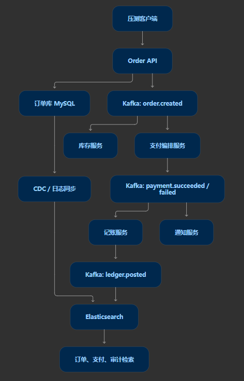

# 项目计划

可以。最适合你现在的不是再写一个 CRUD 商城，而是做一个能把你想学的东西真正串起来的项目：

# 项目：高并发支付订单与记账平台

模拟“用户下单 → 扣库存 → 支付 → 记账 → 通知 → 查询/对账”的系统。重点不在页面，而在可靠性、异步化、可观测性和压测优化。

它和你现在银行会计改造的经验也很连得上，面试时会显得不像纯练手项目。

## 当前实现与快速开始

**已实现**

- 后端 `POST /api/orders`：校验地址 / SKU、价格校验、锁定库存、写入订单 / 明细 / 状态日志
- 后端 `GET /api/products?limit=100`：首页商品列表（按 SPU 聚合 SKU 价格与库存，最多 100 条）
- 支付模块（`ledgerflow-app` 的 `payment` 包）：创建支付单、Mock 渠道回调、回调幂等、晚到/重复支付退款、Outbox 事件，详见 [`docs/payment-api.md`](docs/payment-api.md)
- 前端 `frontend/`：Vue 3 + Vite + TypeScript 商城，支持商品浏览、搜索、分类筛选、加入购物车、购物车结算，以及“订单创建中 → 正在跳转支付界面”的结算弹层

**模块说明**

- 每个 Maven 模块/目录的职责与边界：[`docs/module-design.md`](docs/module-design.md)
- 支付模块具体要做什么、不做什么：[`docs/payment-module.md`](docs/payment-module.md)

**本地启动**

```bash
# 1. MySQL（compose.yml 中目前只有 MySQL）
docker compose up -d

# 2. 初始化演示数据（仅在空库时执行，会写入 10 个 SPU / 20 个 SKU）
docker exec -i ledgerflow-mysql mysql -uroot -p123123 ledgerflow < db/demo/seed.sql

# 3. 构建并启动单体应用（默认 8080；dev profile 才启用 Mock 收银台）
mvn -DskipTests package
java -jar ledgerflow-app/target/ledgerflow-app-0.0.1-SNAPSHOT.jar --spring.profiles.active=dev

# 4. 前端（另开终端，需要 Node 22+）
cd frontend && npm install && npm run dev
```

打开 <http://localhost:5173>。前端通过 Vite proxy 将 `/api` 转发到 `http://localhost:8080`，不需要后端配置 CORS。

**注意**

- 结算使用 seed 用户 1 的收货地址 `addressId=1`，会真实创建订单并锁定库存
- 支付模块已实现 Mock 渠道全链路，但前端还没有支付页；订单创建后仍停在 `PENDING_PAYMENT`，可用 [`docs/payment-api.md`](docs/payment-api.md) 中的 curl 完成支付
- 首次启动应用会自动执行 Flyway V1–V8（支付幂等、订单结算唯一约束、`processed_event`）
- 重复演示前可用 `db/demo/reset.sql` + `db/demo/seed.sql` 重置数据（会清空业务数据）

## 核心架构



## 你能学到的技术点

| 你的目标 | 放在项目里的具体实现 |
| --- | --- |
| Kafka | 订单、支付、记账事件；Consumer Group；分区键；重复消费；死信队列 |
| Elasticsearch | 按订单号、用户、状态、金额范围、时间范围检索；聚合交易额/失败率 |
| 分布式编排 | 支付失败时取消订单、释放库存；Saga 编排与补偿 |
| Benchmark | k6 / JMeter / Gatling 打接口；逐步提高并发 |
| 优化 | SQL 索引、Kafka 批处理、线程池、连接池、ES bulk 写入、缓存 |
| 可观测性 | Prometheus + Grafana；Trace ID；日志关联；延迟和失败率指标 |
| Java 技术展示 | Spring Boot、JPA/MyBatis、事务传播、Outbox、幂等、JUnit/Testcontainers |

## 建议的业务流程

例如用户请求：

`POST /orders`

1. Order 服务本地事务写入订单，初始状态 `PENDING`
2. 同一事务写入 `outbox_event` 表
3. Outbox 发布器把事件可靠投递给 Kafka
4. 支付编排服务消费订单事件，调用“模拟支付渠道”
5. 成功：发出 `payment.succeeded`，记账服务生成借贷分录，订单变 `PAID`
6. 失败：发出 `payment.failed`，订单取消、库存释放
7. 所有事件带 `eventId` 和 `traceId`，消费者用去重表保证幂等
8. 已完成订单与支付流水异步写入 Elasticsearch，提供搜索与聚合接口

这里最有价值的一点是：**不要靠跨服务的全局事务硬锁住一切**。用本地事务 + Outbox + Kafka + 幂等消费 + 补偿，才是真实分布式系统常见的处理方式。

## 不要一开始拆太多服务

第一版建议先做“模块化单体”，一个 Spring Boot 工程内分模块：

- `catalog`
- `inventory`
- `order`
- `checkout`
- `payment`
- `outbox`
- `common`
- `ledger`（未实现，留空）
- `search`（未实现，留空）

Kafka、MySQL、ES 都是真的外部组件。先把交易链路跑通，再把记账消费者 `ledger` 拆为独立进程；`payment` 等到有独立扩容或分库需求时再拆。这样不会陷入 Docker 和微服务配置地狱。

> 当前实现是单进程模块化单体：`ledgerflow-common`（普通 jar，只放雪花 ID、单号、状态枚举）+ `ledgerflow-app`（唯一 Spring Boot 应用，默认 8080）。业务边界在 `com.ledgerflow.catalog / inventory / order / checkout / payment / outbox` 包中，共享同一个 MySQL 库和本地事务。`ledger`、`search` 与 `ledger-worker` 尚未实现，目录留空。模块边界说明见 [`docs/module-design.md`](docs/module-design.md)。

## 开发路线

### 第一周：能跑通

- Docker Compose 起 MySQL、Kafka、Kafka UI、Elasticsearch
- 下单接口、本地订单表
- Kafka 生产与消费
- 支付成功/失败的模拟流程
- 一篇清晰 README，画出流程图

### 第二周：可靠性

- Outbox Pattern
- 消费幂等：`processed_event` 去重表
- 重试、指数退避、DLQ
- 模拟“消费者处理后宕机”“消息重复投递”
- 写集成测试验证最终状态正确

### 第三周：ES 与可观测性

- 将订单/流水索引进 Elasticsearch
- 写检索、分页、金额和状态聚合
- Micrometer + Prometheus + Grafana
- 观察：吞吐量、P95/P99 延迟、Kafka lag、失败率、数据库连接池

### 第四周：压测与优化报告

- 用 k6 压测：100、500、1000 并发逐档跑
- 先记录基线，再优化一个明确瓶颈
- 例子：
    - 给订单查询加联合索引
    - ES 改 Bulk API
    - Kafka consumer 调整批量拉取/并发
    - 调整 HikariCP、线程池
- 最后写一份性能报告：瓶颈、证据、改动、前后数据、代价

## 一个很适合写进简历的成果表达

> 构建基于 Spring Boot、Kafka、MySQL、Elasticsearch 的异步支付记账平台；通过 Outbox Pattern、幂等消费、重试/DLQ 和 Saga 补偿保障最终一致性。使用 Prometheus/Grafana 与 k6 定位瓶颈并完成压测优化，沉淀吞吐、P99 延迟与 Kafka Lag 等可观测指标。
>

重点是最后那句必须有真实数据，例如“在 X 并发下将 P99 从 Y ms 降至 Z ms”，不用刻意追求很大数字，但过程和证据要可信。

我建议你就从这个做起：它既能覆盖 Kafka / ES / 编排 / benchmark，又正好把你已有的 Java、JMS、事务、SQL 调优经验升级成一条完整的工程能力线。下一步我可以直接帮你定第一版目录结构、Docker Compose 和第一批接口。

学习计划：深度使用 Codex 与 DSH

checklist