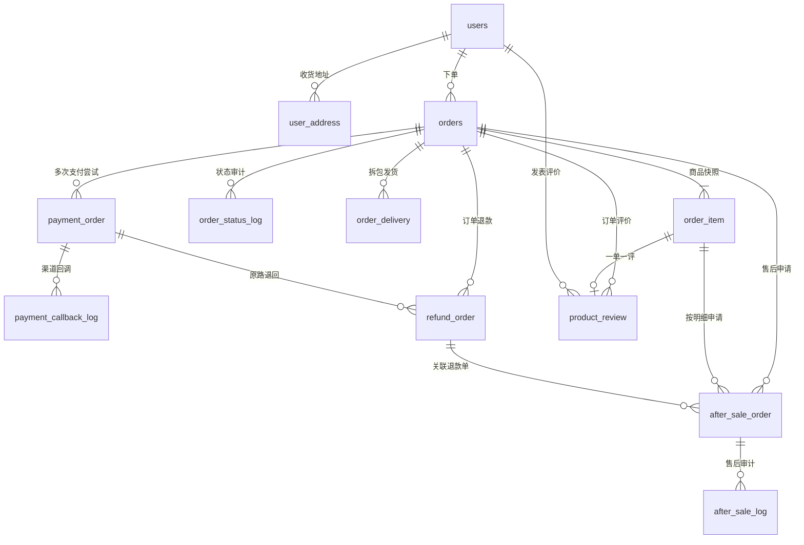
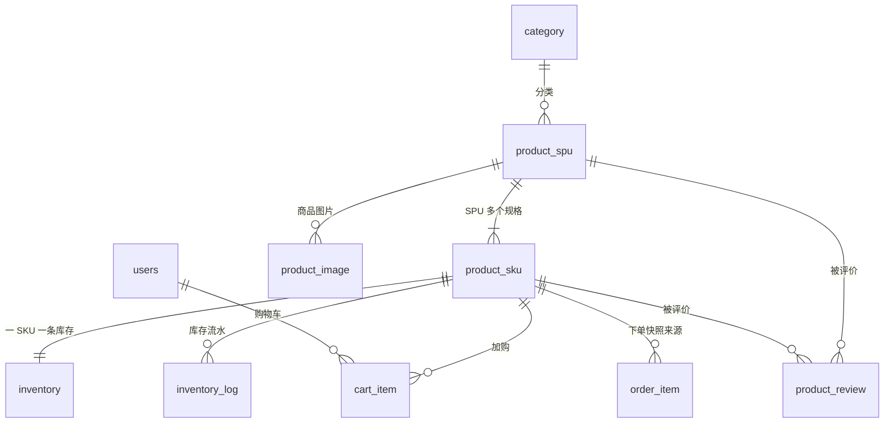
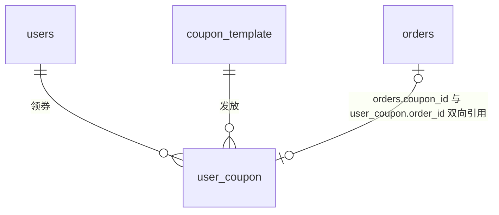

# LedgerFlow 消费场景数据库设计

> 一套用于**本地学习**的电商消费场景数据库：23 张业务表，覆盖用户、商品、库存、购物车、
> 订单、支付、退款、优惠券、评价、售后、Outbox 事件和消费去重。
>
> 目标不是“把表建出来”，而是把真实项目里的问题一起搬进来：超卖、重复支付回调、
> 订单状态机、超时关单、部分退款、优惠券超发/重复使用、深分页、索引失效、对账兜底。
>
> 数据库：MySQL 8.4 / InnoDB / `utf8mb4_0900_ai_ci`；迁移：Flyway V1–V8。
> 本地账号 `root`、密码 `123123` **仅限开发环境**，详见文末“安全与禁忌”。

---

## 1. 快速开始

以下命令默认在项目根目录执行：

```bash
cd /home/wwwsh/projects/ledgerflow
```

### 1.1 启动 MySQL

```bash
docker compose up -d
docker ps --filter name=ledgerflow-mysql
```

### 1.2 建表（Flyway）

应用启动时会自动执行 `classpath:db/migration` 下的迁移：

```bash
sh ledgerflow-common/mvnw spring-boot:run
# 看到 “Successfully applied ... migrations” 后 Ctrl+C 即可
```

`payment-service` 启动时也会执行同一份迁移；两个应用共用 `flyway_schema_history`，
先启动哪个都可以（Flyway 会加锁串行执行）。

已有迁移记录时不会重复建表。检查：

```bash
docker exec -e MYSQL_PWD=123123 ledgerflow-mysql mysql -uroot -t -e "
SELECT COUNT(*) AS business_tables
FROM information_schema.tables
WHERE table_schema = 'ledgerflow' AND table_name <> 'flyway_schema_history';

SELECT version, description, success
FROM ledgerflow.flyway_schema_history ORDER BY installed_rank;"
```

预期：`business_tables = 23`，V1–V8 全部 `success = 1`。

### 1.3 导入样例数据

```bash
docker exec -i -e MYSQL_PWD=123123 ledgerflow-mysql \
  mysql -uroot --default-character-set=utf8mb4 ledgerflow \
  < db/demo/seed.sql
```

`seed.sql` 末尾有 8 条自检，全部应为 `0`。

### 1.4 运行演示查询

```bash
# 基础查询：分页、订单详情、商品列表、购物车、优惠券、全文搜索
docker exec -i -e MYSQL_PWD=123123 ledgerflow-mysql \
  mysql -uroot --default-character-set=utf8mb4 ledgerflow \
  < db/queries/01_basic.sql

# 一致性对账：正常应“没有任何输出”
docker exec -i -e MYSQL_PWD=123123 ledgerflow-mysql \
  mysql -uroot --default-character-set=utf8mb4 ledgerflow \
  < db/queries/02_consistency.sql

# 并发/幂等演示：所有事务最后 ROLLBACK，不改数据
docker exec -i -e MYSQL_PWD=123123 ledgerflow-mysql \
  mysql -uroot --default-character-set=utf8mb4 ledgerflow \
  < db/queries/03_concurrency.sql

# 索引与执行计划：含 5 万行临时表，可反复执行
docker exec -i -e MYSQL_PWD=123123 ledgerflow-mysql \
  mysql -uroot --default-character-set=utf8mb4 ledgerflow \
  < db/queries/04_index_explain.sql
```

> `02_consistency.sql` 在 mysql 批处理模式下，结果集为空时**什么都不打印**。
> 没有输出、退出码为 0，就是全部对账通过。

### 1.5 重置样例数据

```bash
# 只清空 23 张业务表，保留表结构和 Flyway 历史
docker exec -i -e MYSQL_PWD=123123 ledgerflow-mysql \
  mysql -uroot --default-character-set=utf8mb4 ledgerflow \
  < db/demo/reset.sql

# 再导入
docker exec -i -e MYSQL_PWD=123123 ledgerflow-mysql \
  mysql -uroot --default-character-set=utf8mb4 ledgerflow \
  < db/demo/seed.sql
```

如果连表结构都要重来（**会删除数据卷，必须先确认**）：

```bash
docker compose down -v      # 危险：删除 mysql-data 卷
docker compose up -d
sh ledgerflow-common/mvnw spring-boot:run   # 重新跑 Flyway
```

---

## 2. 数据模型总览

### 2.1 交易与售后链路



要点：

- 一个订单可以有**多条支付单**（失败换渠道重试），所以 `payment_order.order_no` 不唯一；
- 一个订单可以有**多个包裹**（拆包发货），所以 `order_delivery` 是 1:N；
- 退款挂在支付单/订单上，售后挂在订单明细上，二者通过 `refund_no` 关联；
- 评价通过 `order_item_id` 唯一键保证“一个订单行只能评一次”。

### 2.2 商品、库存与购物车



SPU 是“商品”（如某款耳机），SKU 是“可售规格”（颜色/容量）。价格、库存、
加购、下单都落在 SKU 上；订单明细同时保存 `spu_id` 和 `sku_id`，方便按商品聚合。

### 2.3 优惠券：一个刻意保留的循环引用



`orders.coupon_id` 指向用掉的券，`user_coupon.order_id` 又指回订单。默认没有物理外键时
这只是逻辑环；执行 `db/optional/foreign_keys.sql` 后，写入顺序会变成：

1. 先插订单，`coupon_id = NULL`；
2. 再插用户券，`order_id = 新订单 id`；
3. 最后 `UPDATE orders SET coupon_id = 新券 id`。

删除时则要先把两侧可空引用置 `NULL`。`seed.sql` 和 `reset.sql` 已经按这个顺序处理。

---

## 3. 表清单

### 3.1 用户域

| 表 | 作用 | 关键设计 |
|---|---|---|
| `users` | 用户账号 | `uk_user_no`、`uk_username`；生成列 `active_phone` / `active_email` + 唯一索引，软删除后可复用手机号/邮箱 |
| `user_address` | 收货地址 | 省市区分列存储；生成列 `default_owner` + 唯一索引，保证每人最多一个默认地址 |

### 3.2 商品域

| 表 | 作用 | 关键设计 |
|---|---|---|
| `category` | 两级分类 | `uk_parent_name`、`idx_parent_sort`；`path` 保存祖先路径，便于查子树 |
| `product_spu` | 标准商品单元 | `uk_spu_no`、`idx_category_status(category_id,status,id)`；`ft_title` 为 ngram 全文索引 |
| `product_sku` | 可售规格 | `uk_sku_no`、`idx_spu_id`；`spec_json` 存颜色/容量等，`spec_summary` 供展示 |
| `product_image` | 商品图片 | `idx_spu_sort(spu_id,sort)`；详情图与主图共用 |

### 3.3 库存与购物车

| 表 | 作用 | 关键设计 |
|---|---|---|
| `inventory` | 每个 SKU 一条库存 | `sku_id` 既是主键也是“热行”；`available/locked/sold` 三个计数器均 `CHECK >= 0` |
| `inventory_log` | 库存变更流水 | `uk_biz(biz_type,biz_no,sku_id,change_type)` 作为消息幂等闸门 |
| `cart_item` | 购物车行 | `uk_user_sku` 防止同一 SKU 重复加购；`idx_user_updated` 支撑“最近加购” |

### 3.4 订单域

| 表 | 作用 | 关键设计 |
|---|---|---|
| `orders` | 订单主表 | `uk_order_no`；`uk_user_client_token(user_id, client_token)` 支撑创建订单幂等；`idx_user_created(user_id, created_at DESC, id DESC)` 支撑“我的订单”；`idx_status_expire` 支撑超时扫描；收货地址为快照 |
| `order_item` | 订单明细 | 商品名、规格、图片、单价均为下单时快照；只增不改；`idx_order_id`、`idx_sku_id`、`idx_spu_id` |
| `order_status_log` | 状态流转审计 | `idx_order_id(order_id,id)`；`from_status` 首次为 `NULL`；记录操作者类型 |
| `order_delivery` | 物流包裹 | `uk_delivery_no`、`idx_order_id`、`idx_tracking_no`；支持拆包，状态独立推进 |

### 3.5 支付与退款

| 表 | 作用 | 关键设计 |
|---|---|---|
| `payment_order` | 支付尝试 | `uk_payment_no`；`uk_channel_trade(channel,external_trade_no)` 防渠道单号重复；同一订单允许多条，`idx_status_expire` 支撑关单 |
| `payment_callback_log` | 渠道回调原文 | `uk_channel_notify(channel,notify_id)` 作为回调幂等唯一闸门；保存 `raw_body` 便于排查 |
| `refund_order` | 退款单 | `uk_refund_no`；`uk_channel_refund(channel,channel_refund_no)`；支持同一支付多次部分退款，累计金额由应用锁 + 对账 SQL 兜底 |

### 3.6 营销、售后与基础设施

| 表 | 作用 | 关键设计 |
|---|---|---|
| `coupon_template` | 优惠券模板 | `uk_code`；`idx_status_valid`；`issued_count` 用条件更新防超发 |
| `user_coupon` | 用户持有的券 | `idx_user_status(user_id,status,expire_at)`；`status=0` 条件更新防重复使用；`order_id` 记录核销订单 |
| `product_review` | 商品评价 | `uk_order_item` 保证一单一评；`idx_sku_created` 支撑商品评价列表；`images` 为 JSON 数组 |
| `after_sale_order` | 售后单 | `uk_after_sale_no`；`after_sale_type` 区分仅退款/退货退款/换货；`refund_no` 关联退款单 |
| `after_sale_log` | 售后状态日志 | `idx_after_sale_id(after_sale_id,id)`；商家/用户/系统三类操作者 |
| `outbox_event` | 事务内事件表 | `uk_event_id`；`idx_status_next(status,next_retry_at)` 供发布任务扫描；支持重试退避 |

---

## 4. 状态枚举字典

所有状态都用 `TINYINT UNSIGNED`，具体含义只写在列注释和应用枚举里。原因是 MySQL
`ENUM` 增加取值要 `ALTER TABLE`，跨服务也不便共享。

| 表.字段 | 取值 |
|---|---|
| `users.status` | `0` 禁用、`1` 正常 |
| `users.member_level` | `0` 普通、`1` 白银、`2` 黄金 |
| `user_address.is_default` | `0` 否、`1` 是（软删除后生成列自动置 `NULL`） |
| `category.level` / `status` | 级别 `1/2`；状态 `0` 禁用、`1` 启用 |
| `product_spu.status` | `0` 下架、`1` 上架、`2` 草稿 |
| `product_sku.status` | `0` 下架、`1` 上架 |
| `inventory_log.change_type` | `1` 锁定、`2` 解锁、`3` 扣减、`4` 回补、`5` 调整 |
| `orders.order_status` | `0` 待支付、`10` 已支付、`20` 已发货、`30` 已完成、`40` 已取消、`50` 售后中、`60` 已退款 |
| `order_status_log.operator_type` | `1` 用户、`2` 管理员、`3` 系统 |
| `order_delivery.status` | `0` 待发货、`1` 已发货、`2` 运输中、`3` 已签收 |
| `payment_order.channel` | `ALIPAY`、`WECHAT`、`BALANCE` |
| `payment_order.status` | `0` 待支付、`1` 成功、`2` 失败、`3` 已关闭 |
| `payment_callback_log.process_status` | `0` 已接收、`1` 处理成功、`2` 处理失败 |
| `refund_order.status` | `0` 已申请、`1` 处理中、`2` 成功、`3` 拒绝、`4` 失败 |
| `coupon_template.coupon_type` | `1` 满减、`2` 折扣 |
| `coupon_template.status` | `0` 停用、`1` 进行中、`2` 已结束 |
| `user_coupon.status` | `0` 未使用、`1` 已使用、`2` 已过期 |
| `product_review.rating` / `status` | 评分 `1–5`；状态 `0` 隐藏、`1` 展示 |
| `after_sale_order.after_sale_type` | `1` 仅退款、`2` 退货退款、`3` 换货 |
| `after_sale_order.status` | `0` 已申请、`1` 已同意、`2` 已拒绝、`3` 退货中、`4` 已完成、`5` 已关闭 |
| `after_sale_log.operator_type` | `1` 用户、`2` 商家、`3` 系统 |
| `outbox_event.aggregate_type` | `ORDER`、`PAYMENT`、`REFUND` |
| `outbox_event.status` | `0` 待发布、`1` 已发布、`2` 发布失败 |

### 库存三字段的算术约定

这是整套 schema 最容易写错的地方，先约定清楚：

| 业务动作 | `change_type` | `available_stock` | `locked_stock` | `sold_stock` |
|---|---:|---|---|---|
| 下单锁定 | 1 | `-qty` | `+qty` | 不变 |
| 取消/超时解锁 | 2 | `+qty` | `-qty` | 不变 |
| 支付成功扣减 | 3 | **不变** | `-qty` | `+qty` |
| 退货回补 | 4 | `+qty` | 不变 | `-qty` |
| 人工调整 | 5 | 按业务定 | 按业务定 | 按业务定 |

- `locked_stock` 只统计“待支付订单占用的库存”；
- `sold_stock` 统计已支付数量（订单状态 `10/20/30/50/60`）；
- **仅退款不恢复库存**（商品没退回），只有退货退款才走 `change_type = 4`；
- 所有变更先写 `inventory_log`（唯一键幂等闸门），再改计数，二者必须在同一事务。

### 核心不变量（`02_consistency.sql` 逐条检查）

```
orders.total_amount  = SUM(order_item.item_amount)
orders.pay_amount    = total_amount - discount_amount + freight_amount
order_item.item_amount = unit_price * quantity
成功支付金额          = orders.pay_amount
累计退款金额(0/1/2)   <= orders.pay_amount
库存三个计数器         >= 0
user_coupon.status=1  <=> orders.coupon_id 指向它且 order_id 回指当前订单
订单当前状态           = 最后一条 order_status_log.to_status
已支付订单             = 必须存在成功支付单
```

---

## 5. 设计取舍

### 5.1 自增主键 + 独立业务号

- 主键用 `BIGINT UNSIGNED AUTO_INCREMENT`：InnoDB 聚簇索引按主键顺序写入，
  页分裂少；二级索引只存主键，比 UUID 更短。
- 对外用业务号：`order_no`、`payment_no`、`refund_no`、`after_sale_no`、`spu_no`、`sku_no`。
  业务号唯一、可读、可跨库关联，不暴露自增规模。
- 分布式/分库分表场景可换 Snowflake/号段；代价是时钟回拨、workerId 管理和更长的索引。
  本库保持自增，方便学习和手工造数。
- 应用层的 `order_no` 已改用雪花算法生成（`SnowflakeIdGenerator`），新订单号是
  `LF + 18~19 位数字`，不再有可读的日期流水含义；`seed.sql` 中的 `LF...` 编号保留用于对照学习。

### 5.2 金额用 `DECIMAL(18,2)`，不用 `FLOAT`/`DOUBLE`

`FLOAT/DOUBLE` 是二进制浮点，`0.1 + 0.2 != 0.3`，对账会出现“差一分”。
`DECIMAL` 是精确十进制，MySQL 内部按字符串/整数存储。Java 侧对应 `BigDecimal`，
比较用 `compareTo`，不要用 `equals`；舍入规则统一在应用层（如 `HALF_UP`）。

另一种常见方案是“金额存分、用 `BIGINT`”。它避免了小数，但所有展示、汇率、折扣计算
仍要转成小数，容易在边界漏乘 100。本项目选择 `DECIMAL`，让 SQL 可读性更好。

### 5.3 订单快照：历史不能跟着商品改

订单明细保存 `product_name`、`sku_spec`、`image_url`、`unit_price`；订单主表保存
收货人、电话、省市区、详细地址。原因：

- 商品改名/改价/下架后，历史订单必须仍然显示下单时的信息；
- 用户改地址/删地址后，历史订单的收货信息不能消失；
- 对账以订单快照和支付金额为准，不依赖当前商品表。

代价是数据冗余。订单明细是**只增不改**的，退款/售后也不回写商品快照。

### 5.4 软删除 + 生成列唯一索引

`users`、`user_address`、`product_spu`、`product_sku` 用 `deleted_at` 软删除。
但 MySQL 的唯一索引会把 `NULL` 视为互不相等，所以：

```sql
active_phone = IF(deleted_at IS NULL, phone, NULL)
active_email = IF(deleted_at IS NULL, email, NULL)
```

再对生成列建唯一索引：未删除的行互相约束，已删除的行都是 `NULL`，不冲突。
`user_address` 同理：

```sql
default_owner = IF(is_default = 1 AND deleted_at IS NULL, user_id, NULL)
```

保证每个用户最多一个默认地址，且软删除旧默认地址后可以设置新的默认地址。
生成列必须是确定性表达式，STORED 会占存储但可以建索引。

### 5.5 默认不建物理外键

这是刻意的取舍，不是遗漏：

- 高并发写入时，外键检查会增加锁和级联风险；
- 在线 DDL、批量归档、分库分表时，跨库外键无法维护；
- 跨服务边界（订单、支付、库存）本来就不能靠数据库外键保证一致性。

一致性由三层兜底：**应用事务 + 条件更新 + 对账 SQL**（`02_consistency.sql`）。
代价是可能出现孤儿数据，必须靠巡检发现。

想亲手体验外键，可执行 `db/optional/foreign_keys.sql`（34 条约束），
观察插入/删除顺序、循环引用和错误码 1451/1452。该脚本只用于学习，默认不执行。

### 5.6 库存：三字段 + 行内条件更新

把“可用、锁定、已售”拆开，才能表达“下单占库存、支付才扣减、取消要释放”：

- 下单：`available -= qty, locked += qty`，条件 `available >= qty`；
- 支付：`locked -= qty, sold += qty`，条件 `locked >= qty`；
- 取消：`available += qty, locked -= qty`，条件 `locked >= qty`。

判断和修改放在**同一条 UPDATE** 里，InnoDB 行锁会保证原子性，避免“先查后改”的丢更新。
`version` 字段供乐观锁场景使用（见 `03_concurrency.sql` 第 2 节）。

`inventory` 一行对应一个 SKU，热点 SKU 会成为“热行”。真实大促会把库存拆成多个桶
（如 `inventory_bucket`），或把扣减放到 Redis/Lua，DB 只做异步落账。本项目保留单行模型，
先把条件更新和幂等讲清楚。

### 5.7 支付单、回调日志、退款单分离

- `payment_order` 允许一个订单多次尝试（失败换渠道/重新发起），`external_trade_no`
  与渠道组成唯一键，防止同一渠道单号被重复入账；
- `payment_callback_log` 保存原始回调和处理状态，`(channel, notify_id)` 唯一，
  让渠道重复通知只落一条；
- `refund_order` 独立于支付单，支持多次部分退款；累计金额不能超过支付金额，
  由应用在支付单行锁下校验，`02` 的对账 SQL 兜底。

订单状态和支付状态是两套状态机，通过条件更新推进，不互相覆盖。

### 5.8 状态用 TINYINT + 状态日志

- 状态值用 `TINYINT UNSIGNED`，列注释记录枚举；应用用枚举类映射；
- 每次流转写 `order_status_log` / `after_sale_log`，记录 `from_status`、`to_status`、
  操作者类型和原因；
- 应用更新必须是 `UPDATE ... WHERE order_status = 期望值`，影响 0 行就说明状态已变，
  不能重试成“覆盖写”。

状态机示例：

```
0 待支付 → 10 已支付 / 40 已取消
10 已支付 → 20 已发货 / 50 售后中
20 已发货 → 30 已完成 / 50 售后中
50 售后中 → 30 已完成 / 60 已退款
```

### 5.9 时间统一 UTC，用 `DATETIME(3)`

- 不用 `TIMESTAMP`：它受会话时区影响，且有 2038 问题；
- 统一存 UTC，JDBC 连接参数 `connectionTimeZone=UTC`，展示时再转用户时区；
- 毫秒精度 `DATETIME(3)` 足够订单/支付排序；演示脚本固定
  `@now = '2026-10-26 12:00:00.000'`，保证结果可复现。

### 5.10 规格用 JSON，但别把查询寄托在 JSON 上

`product_sku.spec_json` 存 `{"颜色":"黑","容量":"256G"}`，`spec_summary` 存
“黑色 / 256G”供列表展示。好处是新增规格不用改表；坏处是任意属性查询需要
`JSON_EXTRACT`，无法直接走普通索引。

真实项目会把高频筛选属性提成列，或建生成列 + 索引；低频属性才留在 JSON 里。

### 5.11 深分页用游标，不用大 OFFSET

`OFFSET 49980` 会先按索引顺序取出 49980 行再丢弃。正确做法是用上一页最后一行的
`(created_at, id)` 作为游标：

```sql
WHERE user_id = ?
  AND (created_at < ?
       OR (created_at = ? AND id < ?))
ORDER BY created_at DESC, id DESC
LIMIT 20;
```

`id` 是 tie-breaker，防止同一毫秒的订单被跳过或重复。

**MySQL 8.4 实测坑点**：行构造器写法 `(created_at, id) < (?, ?)` 语义相同，但在
`(user_id, created_at DESC, id DESC)` 这类 DESC 联合索引上可能退化成
“索引查找 + Filter”，仍然读很多行；展开成上面的 OR 形式可以稳定走索引范围扫描。
详见 `db/queries/04_index_explain.sql` 第 5 节。

### 5.12 中文搜索用 ngram 全文索引

`product_spu.title` 上建 `FULLTEXT ... WITH PARSER ngram`。`ngram_token_size` 默认 2，
所以“耳机”“咖啡”能命中，单个汉字通常不行。`LIKE '%耳机%'` 的前置通配符无法使用
B-Tree 索引，只能全表扫描。

### 5.13 Outbox：事务内写事件，事务外投递

业务事务里同时写 `outbox_event`（状态 `0`），后台任务按
`idx_status_next(status, next_retry_at)` 扫描并投递 Kafka，成功后置 `1`，失败置 `2`
并按 `retry_count` 退避。这样避免了“数据库提交成功、消息发送失败”的双写不一致。

投递语义是**至少一次**，消费方仍必须幂等（例如用 `inventory_log.uk_biz` 或业务唯一键）。

### 5.14 下单幂等：client_token + request_hash

V7 给 `orders` 增加三个东西：

- `client_token`：客户端为一次下单意图生成的幂等键；
- `request_hash`：规范化请求体的 SHA-256，用于识别同一个 token 是否携带了不同内容；
- `uk_user_client_token(user_id, client_token)`：并发下的最终唯一闸门。

同一个 token 的重试返回同一订单；同一个 token 搭配不同 `request_hash`，说明 key 被复用，
应返回 `409 IDEMPOTENCY_KEY_CONFLICT`，不能静默返回旧订单，也不能再插一单。
两列允许 `NULL`，兼容 V7 之前的订单；新订单由应用层保证非空。token 与 hash 使用
`ascii_bin`，避免默认 `ai_ci` 大小写不敏感把 `ABC` 和 `abc` 当成同一个键。

---

## 6. 真实问题 → 设计/脚本映射

| 真实问题 | 设计支点 | 可执行演示 |
|---|---|---|
| 超卖 | `UPDATE ... WHERE available_stock >= qty` + `CHECK >= 0` | `03` 第 1 节 |
| 并发丢更新 | `version` 乐观锁 + 重试 | `03` 第 2 节 |
| 重复支付回调 | `payment_callback_log.uk_channel_notify` | `03` 第 3、4 节 |
| 重复下单 | `orders.uk_user_client_token` + `request_hash` | schema（V7）、练习题 6 |
| 非法状态流转 | 条件更新 + `order_status_log` | `03` 第 3 节 |
| 超时关单、多实例重复关单 | `idx_status_expire` + 条件“抢单” + 释放库存 | `03` 第 7 节 |
| 库存消息重复消费 | `inventory_log.uk_biz` + 先插流水再改库存 | `03` 第 6 节 |
| 优惠券超发 | `UPDATE ... WHERE issued_count < total_count` | `03` 第 5.1 节 |
| 优惠券重复使用 | `UPDATE ... WHERE status = 0` | `03` 第 5.2 节 |
| 部分退款累计超额 | 支付单行锁 + 对账 SQL | `02` 第 3 节 |
| 订单/支付/退款对账 | 多表金额与状态校验 | `02` 全文 |
| 无外键导致孤儿数据 | `NOT EXISTS` 巡检 | `02` 第 9 节 |
| 商品改价影响历史订单 | 订单明细快照 | `01` 第 2 节 |
| 软删除后手机号不能复用 | 生成列 `active_phone` + 唯一索引 | schema |
| 默认地址只能有一个 | 生成列 `default_owner` + 唯一索引 | schema |
| 订单列表越翻越慢 | 游标分页 + `idx_user_created` | `01` 第 1 节、`04` 第 1/5 节 |
| 中文商品搜索 | ngram 全文索引 | `01` 第 6 节、`04` 第 4 节 |
| 对列做函数导致索引失效 | 改写为常量范围 | `04` 第 6 节 |
| 事件与业务双写不一致 | `outbox_event` + 至少一次投递 | schema、`02` 第 10 节 |
| 拆包发货 | `order_delivery` 1:N | `01` 第 2.5 节 |
| 热点 SKU 行锁竞争 | 单行条件更新（进阶：库存分桶） | `03` 第 1 节注释 |

---

## 7. 样例数据导读

`seed.sql` 是可重复执行的显式主键数据：

| 数据 | 数量 | 说明 |
|---|---:|---|
| 用户 / 地址 | 10 / 12 | 手机号 `13800000001..10`；密码明文 `123456` 的 BCrypt 哈希 |
| 分类 / SPU / SKU | 5 / 10 / 20 | 数码、服饰、食品、家电、美妆 |
| 库存 / 流水 | 20 / 14 | 流水覆盖部分订单，不追求全量审计 |
| 购物车 | 3 | 用户 1 的结算预览 |
| 订单 / 明细 / 状态日志 | 15 / 18 / 46 | 覆盖全部订单状态 |
| 物流包裹 | 9 | 含拆包 |
| 支付单 / 回调日志 | 14 / 6 | 同一订单可有失败后换渠道重试 |
| 退款单 | 2 | 1 笔部分退款处理中，1 笔全额退款成功 |
| 优惠券模板 / 用户券 | 3 / 6 | 未使用、已使用、已过期 |
| 评价 / 售后单 / 售后日志 | 5 / 2 / 5 | 售后与退款关联 |
| Outbox 事件 | 3 | 待发布、已发布 |

### 7.1 重点订单

| 订单 | 状态 | 教学点 |
|---|---|---|
| `LF202610260001` | 0 待支付 | 未超时（`expire_at` 23:00）；`PAY202610260001` 待支付；`03` 第 3 节用它演示支付回调与非法取消 |
| `LF202610200001` | 0 待支付 | **已超时但仍占着库存**（SKU 2 `locked_stock=1`）；`03` 第 7 节演示关单、释放库存、写日志，最后回滚 |
| `LF202610010001` | 10 已支付 | 使用优惠券 1（NEW20 满减 50）；订单与 `user_coupon` 双向回填 |
| `LF202610050001` | 10 已支付 | 运费 10 元：`258 + 10 = 268`；有一条失败支付 + 一条成功支付 |
| `LF202610100001` | 20 已发货 | 物流状态在途 |
| `LF202609050001` | 30 已完成 | 两个商品、一次成功支付、已签收；`01` 第 2 节订单详情样例 |
| `LF202609200001` / `LF202609220001` | 40 已取消 | 分别对应用户取消/超时取消；库存已解锁 |
| `LF202610080001` | 50 售后中 | 扫地机器人部分退款 500 元处理中（`refund_order.status=1`） |
| `LF202610120001` | 60 已退款 | 坚果礼盒全额退款 209 元成功；**仅退款不恢复库存**（SKU 10 不变） |

### 7.2 重点库存

- SKU 17（精华）：`available=297, locked=0, sold=3, version=2`，`03` 第 1 节防超卖样例；
- SKU 1（待支付订单 1）：`available=99, locked=1, sold=0`，`03` 第 6 节支付扣减样例；
- SKU 2（超时订单 2）：`available=59, locked=1, sold=0`，`03` 第 7 节关单释放样例。

### 7.3 自检与对账

`seed.sql` 末尾 8 条自检覆盖金额公式、成功支付、退款上限、库存非负、优惠券双向一致：

```text
订单总额与明细不一致            0
订单应付金额公式不成立          0
订单行金额公式不成立            0
成功支付金额与订单不符          0
退款金额超过支付金额            0
库存出现负数                    0
优惠券与订单双向不一致          0
订单引用的券未标记已使用        0
```

`02_consistency.sql` 是更完整的只读巡检，正常**零输出**。

---

## 8. 演示脚本说明

### `01_basic.sql`：常规查询

1. “我的订单”游标分页，并与 OFFSET 对比；
2. 订单详情：主表、明细、金额对账、支付尝试、物流、状态日志；
3. 分类商品聚合（注意 `ONLY_FULL_GROUP_BY`）与 SPU/SKU 列表；
4. 购物车结算预览：购物车不存价格，结算时重读 SKU 价格与库存；
5. 用户可用优惠券；
6. ngram 全文搜索“耳机”“咖啡”。

### `02_consistency.sql`：对账巡检

10 组检查：订单金额、支付、退款、库存、优惠券、状态机与日志、时间戳与物流、
评价与售后、孤儿数据、回调与 Outbox。结果集为空即通过。

### `03_concurrency.sql`：并发与幂等

所有写操作都在 `START TRANSACTION ... ROLLBACK` 中，执行后数据不变。
关键工具是 `ROW_COUNT()`：条件不满足时返回 0，应用应把它当作“状态已变化/已处理”，
而不是失败重试。

预期断言（共 22 个）：

| 小节 | 变量 → 期望值 |
|---|---|
| 1 防超卖 | `buy_one_affected=1`、`oversell_affected=0` |
| 2 乐观锁 | `optimistic_first=1`、`optimistic_stale=0` |
| 3 状态机 | `pay_claimed=1`、`order_paid=1`、`duplicate_callback=0`、`invalid_cancel=0` |
| 4 回调幂等 | `first_notify=1`、`duplicate_notify=0` |
| 5 优惠券 | `first_claim=1`、`sold_out_claim=0`、`first_use=1`、`duplicate_use=0` |
| 6 库存流水幂等 | `first_log=1`、`stock_updated=1`、`duplicate_log=0` |
| 7 超时关单 | `claimed=1`、`released_skus=1`、`unlock_log=1`、`status_log=1`、`second_worker=0` |

### `04_index_explain.sql`：索引与执行计划

1. `idx_user_created` 同时满足过滤与排序，无 `Using filesort`；
2. `idx_status_expire` 的等值 + 范围组合，只查 `id` 时覆盖索引；
3. `uk_channel_notify` 唯一键等值查找 `type=const`，只给 `notify_id` 则用不上最左前缀；
4. ngram 全文索引 vs `LIKE '%耳机%'` 全表扫描；
5. 5 万行临时表对比 `OFFSET 49980` 与游标分页（含上述行构造器退化说明）；
6. `DATE(created_at)` 导致索引失效，改成常量范围后恢复 `range`。

> 脚本必须整文件执行，临时表才跨语句存在；结束时已 `DROP TEMPORARY TABLE`。

---

## 9. 可选：物理外键学习

`db/optional/foreign_keys.sql` 会补充 34 条外键（先补 8 个子表索引），全部
`ON DELETE RESTRICT ON UPDATE RESTRICT`：不级联删除、不静默置空，让错误暴露出来。

```bash
docker exec -i -e MYSQL_PWD=123123 ledgerflow-mysql \
  mysql -uroot --default-character-set=utf8mb4 ledgerflow \
  < db/optional/foreign_keys.sql
```

建议顺序：Flyway 建表 → 导入 seed → 执行 FK 脚本。验证 SQL 在脚本第 7 节：

- `fk_count = 34`；
- 插入不存在的用户/商品 → `ERROR 1452`；
- 删除仍被引用的父行 → `ERROR 1451`；
- 修改被引用的业务号 → `ERROR 1451`；
- 循环引用按第 6 节三步写入。

移除外键：脚本第 8 节，默认全部注释，按需取消注释执行。删除外键不会自动删除索引。

> 建议在临时库验证 FK 脚本，不要随手在生产/共享库执行。MySQL 外键检查是立即的，
> 没有 `DEFERRABLE`；一旦加上，seed/reset 的每一步顺序都会被强制。

---

## 10. 练习题

1. **超时关单任务**：扫描 `order_status=0 AND expire_at<=NOW(3)`，条件更新抢占，
   释放库存、写流水、写状态日志、写 outbox。多实例并发时如何保证只释放一次？
   提示：`03` 第 7 节 + `FOR UPDATE SKIP LOCKED`。
2. **把条件扣减改成乐观锁重试**：读 `version` → 计算 → `WHERE version=?`；
   影响 0 行时重读重试。比较两种写法的锁等待和吞吐。
3. **部分退款上限**：同一支付单多笔退款并发申请，如何保证累计不超过支付金额？
   考虑支付单行锁、退款汇总行、唯一键约束三种方案。
4. **优惠券限领**：`per_user_limit` 在并发下如何保证？为什么 `02` 第 5.3 节只能兜底？
5. **支付对账**：导入渠道账单（可建临时表），找出“渠道有、本地无”“金额不一致”
   “状态不一致”三类差异。
6. **下单幂等**：V7 已提供 `orders.client_token` / `request_hash` 列和
   `uk_user_client_token` 唯一索引；练习重点是把应用层幂等流程接上，
   重复提交时返回同一订单，而不是创建两单。
7. **Outbox 发布器**：用 `SKIP LOCKED` 批量取待发布事件，发送 Kafka，更新状态；
   模拟发送成功但更新失败、发送失败重试、重复投递三种情况。
8. **评价约束**：只允许已完成订单行评价。用应用校验、触发器、物理外键分别怎么做？
   各自代价是什么？
9. **商品属性筛选**：把 `spec_json` 里的“颜色”提成生成列并建索引，对比
   `JSON_EXTRACT` 全表扫描的执行计划。
10. **默认地址切换**：用户把地址 B 设为默认时，如何在同一事务里把 A 置 0、
    B 置 1 而不撞 `uk_default_owner`？如果先插后删会怎样？
11. **订单归档**：设计历史订单表/分区，迁移 1 年前已完成订单，同时保持“我的订单”
    分页可用；归档过程如何避免长事务和主从延迟？
12. **加外键实验**：在临时库执行 FK 脚本，跑 seed/reset，记录每一步顺序要求；
    再移除外键，比较批量导入速度。

---

## 11. 安全与禁忌

1. **`root` / `123123` 只用于本地开发。** `application.yaml` 已支持
   `DB_USERNAME` / `DB_PASSWORD` 环境变量覆盖；生产必须使用密钥管理、最小权限账号
   （不要用 root）、TLS，并禁用公网 3306。
2. **样例密码 `123456` 只用于演示。** 库里存的是 BCrypt 哈希，没有明文；
   真实系统禁止弱口令，禁止把明文密码写入数据库、日志或配置。
3. **`reset.sql` 会删除全部业务数据**，只可在本地/学习库执行。
4. **`docker compose down -v` 会删除数据卷**，执行前必须确认；不要在生产或共享环境使用。
5. **不要修改已应用的 Flyway 迁移文件。** Flyway 会校验 checksum；结构变更请新增
   `V7__...sql`。本地要重来只能清库/重建（破坏性操作）。
6. **`db/optional/foreign_keys.sql` 不是默认 schema 的一部分。** 执行前确认库；
   它会改变写入/删除顺序要求。
7. **`02_consistency.sql` 是只读巡检**，可以放心跑；`03_concurrency.sql` 虽有写语句，
   但全部 `ROLLBACK`。若手工改写成 `COMMIT`，请自行承担数据变化。
8. **订单、支付、退款、库存的金额和状态以数据库对账为准**，不要只信缓存/消息。

---

## 12. 常见问题

**Q：`02_consistency.sql` 跑完什么都没有，是失败了吗？**
A：不是。mysql 批处理模式对空结果集不打印任何内容；退出码 0 且无输出即为通过。

**Q：为什么 `LIMIT @n` 报 `ERROR 1064`？**
A：mysql 命令行只支持字面量 `LIMIT`；预处理语句才支持 `?` 占位符。演示脚本用字面量，
Java/MyBatis 中用 `#{limit}`。

**Q：`SHOW CREATE TABLE` 里中文注释变成 `??`？**
A：`docker exec` 的终端/客户端字符集显示问题，表注释本身是 `utf8mb4`。
用 `--default-character-set=utf8mb4` 并确保终端支持 UTF-8。

**Q：`./mvnw` 报 Permission denied？**
A：用 `sh ledgerflow-common/mvnw ...`。

**Q：Flyway 报 checksum mismatch？**
A：说明改过已应用的迁移。不要改历史文件；新增版本迁移，或仅在本地重建库
（破坏性，先确认）。

**Q：时间为什么和本地差 8 小时？**
A：库内统一 UTC，JDBC 用 `connectionTimeZone=UTC`。展示层负责转用户时区；
演示脚本固定 `@now = '2026-10-26 12:00:00.000'`（UTC）。

**Q：为什么订单 2 超时了却还占着库存？**
A：这是有意保留的教学状态：超时关单是**异步任务**，不是数据库自动行为。
`03` 第 7 节演示如何关单并释放，但最后回滚，方便反复练习。

---

## 13. 目录结构

```
ledgerflow/
├── compose.yml
├── db/
│   ├── README.md                     # 本文档
│   ├── demo/
│   │   ├── seed.sql                  # 小规模真实样例（8 条自检）
│   │   └── reset.sql                 # 清空 23 张业务表
│   ├── queries/
│   │   ├── 01_basic.sql              # 分页、订单详情、商品、购物车、券、搜索
│   │   ├── 02_consistency.sql        # 对账巡检（正常零输出）
│   │   ├── 03_concurrency.sql        # 并发/幂等演示（全部回滚）
│   │   └── 04_index_explain.sql      # EXPLAIN、深分页、索引失效
│   └── optional/
│       └── foreign_keys.sql          # 34 条物理外键（学习用，默认不执行）
└── ledgerflow-common/
    └── src/main/resources/
        ├── application.yaml          # 数据源 + Flyway（env 可覆盖）
        └── db/migration/
            ├── V1__user_and_address.sql
            ├── V2__catalog.sql
            ├── V3__inventory_and_cart.sql
            ├── V4__orders.sql
            ├── V5__payment_and_refund.sql
            ├── V6__marketing_aftersale_outbox.sql
            └── V7__order_idempotency.sql
```
