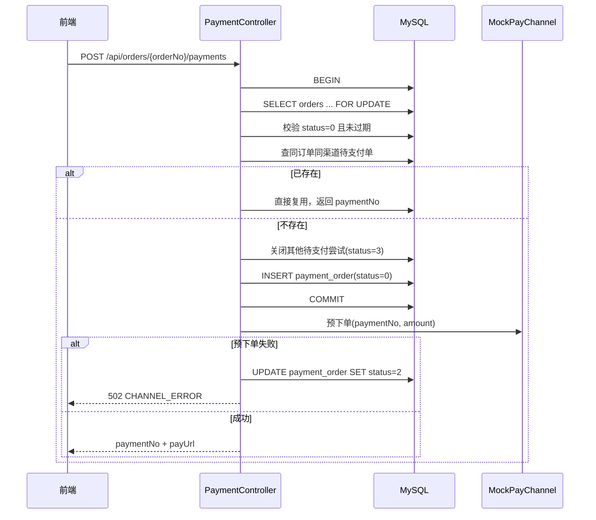
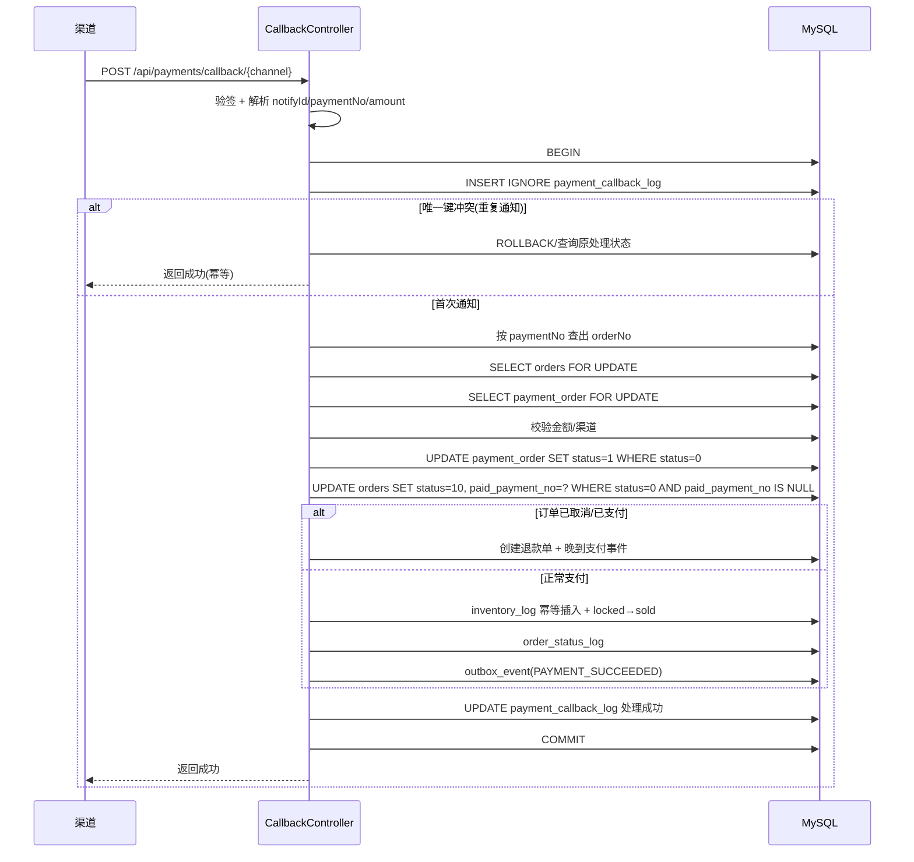

# LedgerFlow 支付模块与消息队列选型

> 结论基于当前仓库的 README、V1–V7 迁移脚本、`CreateService` 和前端结算流程。
> 最后更新：2026-11-03。
>
> **实现说明（2026-11-26）**：支付模块现在位于单体应用 `ledgerflow-app` 的
> `com.ledgerflow.payment` 包，默认 8080，与订单、库存、Outbox 共享 MySQL 和本地事务。
> 本文 1.1 节的现状盘点停留在 2026-11-03，部分结论已过期；当前运行方式见
> [`payment-api.md`](payment-api.md)，模块边界见 [`module-design.md`](module-design.md)，
> 支付职责速览见 [`payment-module.md`](payment-module.md)。

## 0. 一页结论

### 支付模块

**同步核心 + 异步外围 + Outbox 桥接 + 幂等补偿。**

- 支付回调的主链路必须同步完成：`payment_order` → `orders` → `inventory` → `order_status_log` → `outbox_event`，全部在**同一个数据库事务**里。
- 渠道预下单、通知、记账、搜索索引、分析这些操作放到事务外或 Kafka 消费端。
- 回调幂等靠三层：`payment_callback_log.uk_channel_notify`、`UPDATE ... WHERE status = 期望值`、`inventory_log.uk_biz`。
- 超时关单不要依赖 MQ 延迟消息，直接用 `idx_status_expire` 扫库 + 条件更新抢单。
- 必须处理两个真实边界：**回调与关单竞态**、**晚到支付/重复支付**（订单已取消或已支付，钱却到账了 → 退款）。
- 当前 schema 已经够用；建议补一个 V8：支付创建幂等键、订单成功支付引用的唯一约束、`processed_event` 消费去重表。

### 消息队列

**本项目选 Kafka，不引入 RabbitMQ。**

- Kafka 适合：订单/支付/退款领域事件、记账、通知、ES 索引同步、分析、事件重放、Outbox 投递。
- Kafka 不适合：支付回调的同步响应、超时关单这类延迟任务、按消息优先级/复杂路由分发的任务队列。
- RabbitMQ 更适合：低延迟任务队列、延迟消息/重试、复杂路由、优先级队列。本项目当前没有这类硬需求；超时关单用 DB 扫描比 MQ 延迟更可靠。
- 不要同时上两套 MQ。Kafka 已经出现在 `pom.xml` 和 README 的学习目标里，把它用深比多学一个中间件更有价值。如果以后确实要做延迟/重试的对比实验，再把 RabbitMQ 限定在一个旁路场景，不要放进支付主链路。

---

## 1. 现状盘点

### 1.1 已有什么

| 层 | 现状 | 证据 |
|---|---|---|
| 数据库 | 订单、明细、状态日志、库存、支付单、回调日志、退款单、Outbox 表都已建好 | `V4__orders.sql`、`V5__payment_and_refund.sql`、`V6__marketing_aftersale_outbox.sql` |
| 下单 | `POST /api/orders` 已实现：地址/SKU 校验、价格校验、锁库存、写订单/明细/状态日志 | `CreateService.java`、`CreateOrderController.java` |
| 幂等 | V7 已加 `orders.client_token`、`request_hash`、`uk_user_client_token` | `V7__order_idempotency.sql` |
| 前端 | 商品浏览 → 购物车 → 创建订单 → “正在跳转支付界面”结束 | `frontend/src/components/CheckoutModal.vue:134` |
| 消息 | `spring-boot-starter-kafka` 已在依赖里，但没有 compose 服务、没有消费者 | `ledgerflow-app`、`compose.yml` |
| 支付 | **没有 Java 代码**，订单创建后停在 `PENDING_PAYMENT` | `README.md:40` |

### 1.2 关键缺口

| 缺口 | 影响 | 建议 |
|---|---|---|
| `CreateService` 没有接 V7 幂等流程 | 重复提交/网络重试会创建多张订单、重复锁库存 | 先补：`INSERT` 捕获 `DuplicateKeyException` 后按 `(user_id, client_token)` 查回已有订单；同一 token 不同 `request_hash` 返回 `IDEMPOTENCY_KEY_CONFLICT` |
| `CreateService` 没有写 `outbox_event` | 订单创建事件无法可靠投递 Kafka | 下单事务最后写 `ORDER_CREATED` 事件 |
| 没有支付/回调代码 | 支付链路无法跑通 | 按本文第 2 节实现 |
| `payment_order` 没有客户端幂等键 | 双击“去支付”可能创建多笔支付尝试 | 用订单行锁串行化创建；严格场景加 V8 `client_token` |
| 没有“订单只结算一笔支付”的数据库约束 | 两个渠道同时成功时，订单可能被重复推进/重复入账 | V8 加 `orders.paid_payment_no` + 唯一索引（见第 4 节）；第二笔成功支付仍记录，但走退款 |
| 没有 `processed_event` 消费去重表 | Kafka 重复投递会重复记账/重复通知 | V8 建表；记账优先用业务唯一键 `ledger_transaction.uk_biz` |
| 没有记账表 | README 的“记账”环节还没有落点 | 做 Kafka/记账阶段时加 `ledger_transaction` / `ledger_entry` |
| `OrderStatus` 不是枚举 | 状态码散落，容易写错 | 改成 `enum OrderStatus`，统一状态机 |
| 前端支付页缺失 | 用户无法完成支付 | 新增支付页 + 轮询支付状态 |

> 注意：`docs/order-dto-design.md:475` 已经明确“渠道预下单是外部调用，不要放在创建订单的数据库事务里”，本文的支付设计沿用这个结论。

---

## 2. 支付模块设计

### 2.1 设计原则

1. **核心状态同步，外围副作用异步**
   - 同步：支付单、订单状态、库存锁定转已售、状态日志、Outbox。
   - 异步：记账、通知、ES 索引、分析。
   - **支付回调本身不走 Kafka**：渠道需要同步结果，且支付/订单/库存必须在同一个事务里落库；Kafka 只承接事务提交后的副作用。
2. **支付渠道适配器**
   - 定义 `PayChannel` 接口（预下单、验签、解析回调、查询、退款），先实现 `MockPayChannel`，以后换支付宝/微信只加实现类。
3. **金额只信服务端**
   - 创建支付单时金额取 `orders.pay_amount`；回调金额只用于校验，不能用来改订单金额。
4. **状态推进用条件更新**
   - 所有状态变更都带 `WHERE 当前状态 = 期望值`，影响 0 行表示状态已变化，不是失败重试。
5. **至少一次 + 幂等**
   - 不追求端到端 exactly-once；Kafka、回调、定时任务都按“可能重复”设计。
6. **不在数据库事务里做外部调用**
   - 渠道预下单、退款调用放在事务提交后；失败用补偿/重试处理。

### 2.2 状态机

订单状态（`orders.order_status`）：

```text
0 待支付 ──支付成功──▶ 10 已支付 ──发货──▶ 20 已发货 ──签收──▶ 30 已完成
   │                    │
   │                    └──售后──▶ 50 售后中 ──▶ 30 / 60
   ├──用户取消/超时──▶ 40 已取消
   └──晚到支付────────▶ 保持 40，创建退款单（不回到 10）
```

支付单状态（`payment_order.status`）：

```text
0 待支付 ──回调成功──▶ 1 成功
   ├──回调失败──────▶ 2 失败
   ├──超时/换渠道────▶ 3 已关闭
   └──晚到成功──────▶ 1 成功（订单已取消时同时创建退款）
```

**订单状态和支付状态是两套状态机，不能互相覆盖。** 一个订单可以有多笔支付尝试，但订单只结算一笔；额外成功的支付按重复支付处理（退款）。

### 2.3 接口清单

| 方法 | 路径 | 用途 |
|---|---|---|
| `POST` | `/api/orders/{orderNo}/payments` | 创建支付尝试，返回 `paymentNo` / 金额 / 支付参数 |
| `GET` | `/api/payments/{paymentNo}` | 前端轮询支付状态 |
| `POST` | `/api/payments/callback/{channel}` | 渠道异步回调（验签 + 幂等 + 状态推进） |
| `GET` | `/api/orders/{orderNo}` | 支付完成后查订单详情 |
| `POST` | `/api/orders/{orderNo}/cancel` | 用户取消，释放锁定库存（可选，第二阶段） |
| `POST` | `/api/mock-channel/pay/{paymentNo}` | **仅 dev profile**：模拟渠道支付成功/失败，延迟回调 |
| `POST` | `/api/refunds` | 退款（后续阶段） |

创建支付请求示例：

```json
{
  "channel": "MOCK",
  "clientToken": "pay-7f3c2a1b"
}
```

响应示例：

```json
{
  "paymentNo": "PAY373271725637632001",
  "orderNo": "LF373271725637632000",
  "channel": "MOCK",
  "amount": "198.00",
  "status": "PENDING_PAYMENT",
  "expireAt": "2026-11-03T10:10:00Z",
  "payUrl": "http://localhost:5173/mock-pay/PAY373271725637632001"
}
```

### 2.4 创建支付单



关键规则：

1. **先锁订单行**：`SELECT ... FROM orders WHERE order_no = ? FOR UPDATE`，让同一订单的支付创建串行化，避免双击产生两笔支付单。
2. 订单必须属于当前用户、`order_status = 0`、`expire_at > NOW(3)`。
3. 金额只取 `orders.pay_amount`，不接受客户端传金额。
4. 同一订单同一渠道已有待支付单时直接复用；换渠道时先把旧待支付单置为 `3 已关闭`（是否允许并存见 2.7）。
5. `payment_order.expire_at` 建议等于 `orders.expire_at`，不要比订单更晚。
6. 支付单先落库、再调渠道预下单；预下单失败把支付单置为失败/关闭。**不要在事务里调渠道**。
7. 如果服务在“落库成功、预下单前”崩溃，会留下一笔待支付单；由超时任务按 `expire_at` 关闭即可，不需要强一致补偿。
8. 严格 API 幂等可在 V8 给 `payment_order` 加 `(order_no, client_token)` 唯一键；MVP 用订单行锁已经能挡住大部分重复。

### 2.5 支付回调（核心）



回调事务内的推荐顺序（与 `db/queries/03_concurrency.sql` 第 3、4、6 节一致）：

```java
@Transactional
public void handleCallback(String channel, String rawBody, String signature) {
    // 0. 验签 + 解析；验签失败直接拒绝，不入库
    CallbackMessage msg = channel.verifyAndParse(channel, rawBody, signature);

    // 1. 幂等闸门：和业务在同一个事务里。
    //    并发重复回调会在唯一索引上阻塞：第一个提交后，第二个返回 0 行。
    //    第一个回滚时，第二个可以继续处理。
    int inserted = callbackLogMapper.insertIgnore(
            msg.notifyId(), msg.paymentNo(), channel, rawBody);
    if (inserted == 0) {
        // 已处理过。查回调日志：
        //   process_status=1 -> 直接返回成功；
        //   process_status=0 -> 另一个事务仍在处理，返回成功让对方继续；
        //   process_status=2 -> 上次业务失败，确认无并发后可重新处理。
        return;
    }

    // 2. 统一加锁顺序：orders -> payment_order -> inventory(sku_id 升序)。
    //    真实渠道回调通常只带 paymentNo，先无锁读一次拿到 orderNo，
    //    再锁 orders，最后锁 payment_order 并重新校验。
    String orderNo = paymentMapper.findOrderNoByPaymentNo(msg.paymentNo());
    if (orderNo == null) throw new PaymentNotFoundException();
    OrderRow order = orderMapper.selectForUpdateByOrderNo(orderNo);
    PaymentRow payment = paymentMapper.selectForUpdateByPaymentNo(msg.paymentNo());

    if (payment == null) throw new PaymentNotFoundException();
    if (!payment.channel().equals(channel)) throw new ChannelMismatchException();

    // 3. 金额校验：BigDecimal 用 compareTo，不要用 equals（268.00 vs 268.0）
    if (msg.amount().compareTo(payment.amount()) != 0) {
        throw new PaymentAmountMismatchException();
    }

    // 4. 已经成功：重复通知，直接返回成功
    if (payment.status() == PaymentStatus.SUCCESS) return;

    // 5. 支付单推进：条件更新，防并发重复
    int claimed = paymentMapper.markSuccess(payment.paymentNo(), msg.externalTradeNo(), now());
    if (claimed == 0) return;

    // 6. 订单推进：只有待支付且未挂支付单的订单才能变已支付
    int orderChanged = orderMapper.markPaid(order.orderNo(), payment.paymentNo(), now());
    if (orderChanged == 0) {
        // 订单已取消(40/60) 或 已被另一笔支付置为已支付(10)
        // 钱已经到账：记支付成功，创建退款，不改订单状态、不动库存
        refundService.createLateOrDuplicateRefund(payment, msg);
        outbox.append(PAYMENT_LATE_OR_DUPLICATE, payment.paymentNo(), payload(order, payment, msg));
        callbackLogMapper.markProcessed(msg.notifyId(), ProcessStatus.SUCCESS);
        return;
    }

    // 7. 库存 locked -> sold；每行先插 inventory_log 做幂等闸门
    for (OrderItem item : order.itemsSortedBySkuId()) {
        int logInserted = inventoryLogMapper.insertIgnore(
                "ORDER_PAY", payment.paymentNo(), item.skuId(), 3, item.quantity());
        if (logInserted == 1) {
            int updated = inventoryMapper.moveLockedToSold(item.skuId(), item.quantity());
            if (updated == 0) {
                throw new IllegalStateException("库存不一致，回滚并告警");
            }
        }
    }

    // 8. 状态日志 + Outbox + 回调日志状态，同一事务
    orderStatusLogMapper.insert(order.id(), 0, 10, Operator.SYSTEM, 0, "支付成功");
    outbox.append(PAYMENT_SUCCEEDED, payment.paymentNo(), payload(order, payment, msg));
    callbackLogMapper.markProcessed(msg.notifyId(), ProcessStatus.SUCCESS);
}
```

订单结算的唯一性由下面这条 SQL 保证：

```sql
UPDATE orders
SET order_status = 10,
    pay_time = NOW(3),
    paid_payment_no = ?,
    version = version + 1
WHERE order_no = ?
  AND order_status = 0
  AND paid_payment_no IS NULL;
```

影响 0 行有三种可能：订单已取消、已被另一笔支付结算、或已被当前支付结算。前两种走晚到/重复支付退款；第三种说明重复通知，直接返回成功。

几个容易错的点：

- **`INSERT IGNORE` 放在事务第一句**：重复通知要么被唯一键挡住，要么阻塞到第一个事务提交后再返回 0 行。不要“先查日志再插入”，并发下会双处理。
- **失败回调的审计**：如果业务异常导致整个事务回滚，`payment_callback_log` 也会回滚。渠道重试时会重新处理，这是想要的行为；但如果要保留失败尝试，用 `REQUIRES_NEW` 单独写一条失败日志，不要破坏幂等主流程。
- **金额比较用 `compareTo`**：微信金额常用“分”，支付宝用“元”字符串；在渠道适配器里统一转成 `BigDecimal` 元，再比较。
- **先锁 `orders` 再锁 `payment_order`**：和超时关单任务保持同样的加锁顺序，避免死锁。回调报文一般只有 `paymentNo`，所以要先无锁查出 `orderNo`，再按“orders → payment_order”的顺序加锁并重新校验。
- **同一个 `notifyId` 配不同 `paymentNo`**：即使验签通过也要拒绝并告警，防止重放或串单。
- **库存按 `skuId` 升序更新**：多商品订单并发时降低死锁概率（`CreateService` 已经这样做了）。

### 2.6 支付成功后的库存

```sql
-- 1) 幂等闸门：同一支付单、同一 SKU、同一变动类型只允许一条
INSERT IGNORE INTO inventory_log
    (sku_id, change_type, change_qty, before_available, after_available,
     biz_type, biz_no, remark)
VALUES (?, 3, ?, ?, ?, 'ORDER_PAY', ?, '支付成功：锁定转已售');

-- 2) 只有流水插入成功，才更新库存
UPDATE inventory
SET locked_stock = locked_stock - ?,
    sold_stock   = sold_stock + ?,
    version      = version + 1
WHERE sku_id = ?
  AND locked_stock >= ?;
```

- `available_stock` 在支付成功时**不变**；变化的是 `locked_stock` 和 `sold_stock`。`before_available` / `after_available` 都填当前 `available_stock`。
- `biz_no` 用 `payment_no` 而不是 `order_no`：同一订单可能有多笔支付尝试，用支付单号更容易追溯；只有结算订单的那笔支付会走库存扣减，重复/晚到支付直接退款，不动库存。
- 更新 0 行说明库存被别的流程动过（例如超时关单已经释放），必须回滚 + 告警，不要继续提交。

### 2.7 失败、重试、多次支付尝试

| 场景 | 处理 |
|---|---|
| 渠道回调失败 | `payment_order.status=2`，订单保持 `0`，用户可以重新发起支付 |
| 用户换渠道 | 旧待支付单置 `3 已关闭`，新建一笔 `payment_order` |
| 渠道预下单失败 | 支付单置 `2`，返回 `502 CHANNEL_ERROR`，不改变订单 |
| 支付超时 | 由订单超时任务统一关单，同时关闭待支付单 |
| 同一订单多笔支付尝试 | 允许；但订单只结算一笔（V8 唯一约束兜底），其余成功支付走退款 |

> 区分“渠道告知支付失败”和“我们处理回调异常”：前者把 `payment_order.status` 置 `2`；后者回滚事务并返回非成功 ack，让渠道重试。

策略建议：

- **MVP 用“一个订单同时只有一笔活跃支付尝试”**：创建新支付前关闭旧的。逻辑简单，前端也只展示一个支付页。
- 如果要做“多渠道并存，先成功者生效”，必须接受“另一笔也可能成功”的事实，并实现重复支付退款。面试里这是加分项，但第一版不建议增加复杂度。

### 2.8 超时关单与回调竞态

超时关单用定时任务扫库，不用 MQ 延迟消息：

```sql
SELECT id, order_no
FROM orders
WHERE order_status = 0
  AND expire_at <= NOW(3)
ORDER BY expire_at
LIMIT 100
FOR UPDATE SKIP LOCKED;
```

关单事务：

```sql
-- 1) 抢关单权：状态 + 过期时间同时校验
UPDATE orders
SET order_status = 40,
    cancel_time = NOW(3),
    cancel_reason = '支付超时自动关闭',
    version = version + 1
WHERE id = ?
  AND order_status = 0
  AND expire_at <= NOW(3);

-- 2) 释放锁定库存（一单多商品会更新多行）
UPDATE inventory i
JOIN order_item oi ON oi.sku_id = i.sku_id
SET i.available_stock = i.available_stock + oi.quantity,
    i.locked_stock    = i.locked_stock - oi.quantity,
    i.version         = i.version + 1
WHERE oi.order_id = ?
  AND i.locked_stock >= oi.quantity;

-- 3) 关闭待支付单
UPDATE payment_order
SET status = 3, closed_at = NOW(3)
WHERE order_no = ?
  AND status = 0;

-- 4) 状态日志 + Outbox
INSERT INTO order_status_log (...) VALUES (...);
INSERT INTO outbox_event (...) VALUES (...); -- ORDER_CANCELLED
```

竞态分析：

| 谁先拿到 `orders` 行锁 | 结果 |
|---|---|
| 回调先 | 订单 `0 → 10`；关单任务的 `WHERE status=0` 影响 0 行，跳过 |
| 关单先 | 订单 `0 → 40`，库存释放；回调随后 `markPaid` 影响 0 行，走“晚到支付”退款 |
| 两者并发 | 行锁串行化，只有一个能推进状态；不会出现“既已支付又已取消” |

关键点：

- 回调与关单都**先锁 `orders` 行**，保持相同加锁顺序。
- 回调**不要**因为 `payment_order.expire_at` 已过就拒绝；以订单是否仍为 `0` 为准，避免“用户已付款但订单被关单任务抢先”时丢钱。
- 关单任务的库存释放、状态日志、Outbox 必须在同一个事务里；任何一步失败整体回滚，下一轮重新扫到。
- 批量扫描后**逐单处理、每单一个事务**；不要一个事务处理 100 单，避免长事务和“一单失败整批回滚”。

### 2.9 晚到支付与重复支付

这是支付模块最容易被忽略、面试最容易问的场景。

**晚到支付**：订单已超时取消（40），渠道回调成功。

- 不能把订单改回 `10`（库存已释放，可能已被别人买走）。
- 必须记录 `payment_order.status=1`，钱确实收到了。
- 立即创建 `refund_order`（`status=0 已申请`），写 `outbox_event(PAYMENT_LATE_OR_DUPLICATE)`，由退款任务原路退回。
- 对用户展示“支付已到账，订单已关闭，退款处理中”。

**重复支付**：同一订单两笔支付都成功。

- 第一笔把订单推到 `10`；第二笔 `markPaid` 影响 0 行。
- 第二笔同样记成功 + 创建退款，订单保持 `10`。
- V8 的 `orders.uk_paid_payment_no` 保证一个订单只能挂一笔成功支付；第二笔仍然记为 `payment_order.status=1`（钱确实到账），但不挂到订单上，直接走退款。
- 退款金额校验：在 `payment_order` 行锁下聚合 `refund_order`，累计不能超过支付金额。

**退款单字段**（已有表）：

```text
refund_order.payment_no     原支付单
refund_order.order_no       订单号
refund_order.amount         本次退款金额（支持部分退款）
refund_order.status         0 已申请 / 1 处理中 / 2 成功 / 3 拒绝 / 4 失败
refund_order.channel_refund_no 渠道退款单号
```

`uk_channel_refund(channel, channel_refund_no)` 防渠道退款单号重复；累计退款上限由应用在支付单行锁下校验，`02_consistency.sql` 兜底。

> **对账口径要跟着改**：出现重复支付退款后，`SUM(payment_order.amount WHERE status=1)` 可能大于 `orders.pay_amount`。对账时以 `orders.paid_payment_no` 指向的结算支付为准，其余 `status=1` 的支付视为“待退款异常”，不能简单求和后判定订单金额不一致。

### 2.10 幂等与唯一键：现有 + 建议

| 位置 | 现有约束 | 作用 |
|---|---|---|
| 支付回调 | `payment_callback_log.uk_channel_notify(channel, notify_id)` | 同一通知只处理一次 |
| 支付渠道交易号 | `payment_order.uk_channel_trade(channel, external_trade_no)` | 同一渠道交易号不能重复入账 |
| 库存流水 | `inventory_log.uk_biz(biz_type, biz_no, sku_id, change_type)` | 重复消息不重复扣减/回补 |
| 订单创建 | `orders.uk_user_client_token(user_id, client_token)` | 重复下单返回同一订单 |
| 退款渠道单号 | `refund_order.uk_channel_refund(channel, channel_refund_no)` | 重复退款通知只落一条 |
| 订单只结算一笔支付 | **缺失** | V8 `orders.paid_payment_no` 唯一索引 |
| 支付创建幂等 | **缺失** | V8 `(order_no, client_token)` |
| 消费去重 | **缺失** | V8 `processed_event` |

### 2.11 前端交互

1. 结算成功后跳转 `/pay/:paymentNo`，展示金额、倒计时、支付方式。
2. 支付页每 1–2 秒轮询 `GET /api/payments/{paymentNo}`，直到：
   - `SUCCESS` → 跳订单成功页；
   - `FAILED` / `CLOSED` → 展示重试按钮；
   - 倒计时结束 → 提示订单已关闭。
3. Mock 渠道页提供“模拟支付成功 / 模拟支付失败”按钮，调用 `/api/mock-channel/pay/{paymentNo}`，由后端延迟几秒后回调，模拟真实异步通知。
4. 重试支付时复用同一个 `clientToken`，避免重复创建支付单。
5. 前端展示的金额只用于显示，最终以服务端 `orders.pay_amount` 为准。

### 2.12 代码结构建议

沿用当前模块化单体，不急着拆服务：

```text
com.ledgerflow
├─ payment
│  ├─ controller/PaymentController.java
│  ├─ controller/MockChannelController.java      # @Profile("dev")
│  ├─ service/PaymentService.java                # 创建支付单
│  ├─ service/PaymentCallbackService.java        # 回调事务
│  ├─ service/RefundService.java                 # 退款单创建
│  ├─ channel/PayChannel.java                    # 渠道接口
│  ├─ channel/MockPayChannel.java                # 模拟渠道
│  ├─ mapper/...                                 # MyBatis Mapper
│  └─ dto/...
├─ outbox
│  ├─ OutboxAppender.java                        # 事务内写事件
│  └─ OutboxPublisher.java                       # 定时投递 Kafka
├─ ledger                                        # 第三阶段，目前留空
└─ common                                        # 雪花 ID、单号、状态枚举
```

`PaymentTimeoutJob`（超时关单）尚未实现，未创建对应类。

说明：

- 当前 `CreateService` 用 `JdbcTemplate`；支付链路也是事务/条件更新为主，继续用 `JdbcTemplate` 即可。不要同一模块里 JdbcTemplate 和 MyBatis 混着写。
- `PaymentService` 只负责创建支付单；`PaymentCallbackService` 只负责回调事务；`PaymentTimeoutJob` 只负责关单。职责分开，测试好写。
- `PayChannel` 接口至少包含：`prepay`、`verifyAndParseCallback`、`query`、`refund`。Mock 实现里用 HMAC-SHA256 模拟验签。

### 2.13 测试清单

支付正确性主要靠这些用例守住：

| # | 用例 | 期望 |
|---|---|---|
| 1 | 待支付订单创建支付 | 201，`payment_order.status=0` |
| 2 | 已支付/已取消/已过期订单创建支付 | 409 `ORDER_NOT_PAYABLE` / `ORDER_EXPIRED` |
| 3 | 回调成功 | 订单 `10`、支付单 `1`、库存 `locked→sold`、状态日志、Outbox 各一条 |
| 4 | 同一 `notify_id` 重复回调 | 第二次返回成功；只有一条回调日志；库存不重复扣 |
| 5 | 两个线程同时回调同一 `notify_id` | 只有一个事务推进状态；另一个幂等返回 |
| 6 | 回调金额与支付单不一致 | 拒绝，支付单保持 `0`；如启用 `REQUIRES_NEW` 审计，回调日志记失败 |
| 7 | 同一订单两笔支付都成功 | 订单只成功一次；第二笔创建退款 |
| 8 | 超时关单与回调并发 | 最终只能是“已支付”或“已取消 + 退款”，库存不能双动 |
| 9 | 关单任务多实例并发 | 只有一个实例释放库存；`ROW_COUNT()` 抢单 |
| 10 | Kafka 同一事件重复投递 | `processed_event` / 业务唯一键去重，不重复记账 |
| 11 | Outbox 投递失败 | 事件保持待发布，退避重试；不丢事件 |
| 12 | 对账 SQL | 支付金额、退款金额、库存、Outbox 全部零异常 |

并发用例建议用 `CountDownLatch` + 两个线程直接调 Service，不要只测 Controller；Testcontainers 起 MySQL/Kafka 更接近真实。

### 2.14 支付模块落地顺序

**第 1 步：最小闭环（1–2 天）**

- `MockPayChannel` + 创建支付单接口
- 回调成功接口：支付单、订单、库存、状态日志
- 前端支付页 + 轮询
- 重复回调、金额不一致两个测试

**第 2 步：可靠性（2–3 天）**

- `payment_callback_log` 幂等闸门
- 超时关单任务 + 用户取消
- 晚到支付/重复支付退款
- V8 迁移（订单结算唯一约束、支付创建幂等）
- 并发回调/关单竞态测试

**第 3 步：Outbox + Kafka（2–3 天）**

- `OutboxAppender` + `OutboxPublisher`
- Kafka compose + topic + 通知消费者
- `processed_event` 去重
- 重试 + DLQ + 监控指标

**第 4 步：记账与搜索（后续）**

- 记账表 + 支付成功消费者
- ES 索引消费者
- 对账任务 + Prometheus/Grafana

---

## 3. Kafka vs RabbitMQ

### 3.1 一句话区别

- **Kafka 是“可重放的事件日志”**：消息按分区追加、保留一段时间，多个消费组可以各自从头/从任意 offset 读。
- **RabbitMQ 是“消息队列/任务分发器”**：消息被消费并 ack 后删除，强调路由、确认、重试、低延迟。

不是谁更先进，而是语义不同。

### 3.2 对比表

| 维度 | Kafka | RabbitMQ | 对本项目的影响 |
|---|---|---|---|
| 模型 | 分区日志，pull | 队列，push | Kafka 适合事件流，RabbitMQ 适合任务队列 |
| 吞吐 | 很高（单集群十万级 msg/s 很常见） | 高（万级到几万级，取决于持久化/确认） | 本项目量级两者都够，Kafka 更有学习价值 |
| 延迟 | 毫秒级（批量发送会增加） | 亚毫秒到毫秒级 | 支付回调不走 MQ，低延迟不是关键 |
| 消息保留/重放 | 支持，按时间/大小保留 | ack 后删除，默认不能重放 | 重建 ES 索引、补记账、排查问题，Kafka 明显更合适 |
| 顺序 | 分区内有序 | 单队列单消费者有序 | 订单事件按 `orderNo` 分区即可保证同单有序 |
| 路由 | topic + key，能力弱 | exchange/binding，路由灵活 | 本项目不需要复杂路由 |
| 延迟消息/重试 | 无原生延迟，需要外部调度/重试 topic | TTL + DLX / 延迟插件，天然适合 | 超时关单用 DB 扫描更可靠；RabbitMQ 更适合通用延迟任务 |
| 优先级 | 不支持 | 支持优先级队列 | 本项目暂无 |
| 消费模型 | consumer group + rebalance | 竞争消费者 + ack | Kafka 的 consumer group 是 README 的学习目标之一 |
| 运维 | 重（分区、磁盘、KRaft/ZK、rebalance） | 相对轻 | 本地单节点都简单；生产 Kafka 成本更高 |
| 典型场景 | 事件流、CDC、日志、分析、搜索索引、事件重放 | 任务队列、RPC、延迟任务、复杂路由、优先级 | 本项目命中 Kafka 的场景更多 |

### 3.3 本项目的选型结论

**选 Kafka，理由按重要性排序：**

1. README 的学习目标明确包含 Kafka：Consumer Group、分区键、重复消费、死信队列（`README.md:51`）。RabbitMQ 不能替代这些概念。
2. 项目已经有 `outbox_event` 表，天然是“事务内写事件、事务外投递”的模式，Kafka 是标准搭配。
3. 支付成功事件有多个独立消费者：记账、通知、搜索、分析。它们需要各自按自己的节奏消费，甚至重放补数据，这是 Kafka 的强项。
4. 以后要做 ES 索引重建、补记账、排查历史事件，Kafka 的保留/重放能力直接可用。
5. 项目初期是模块化单体，但 Kafka 可以放在“未来会拆成服务”的边界上（payment → ledger / search / notification），先练熟异步契约。

**不选 RabbitMQ 的原因：**

- 当前没有“复杂路由、优先级、低延迟任务队列、通用延迟消息”的硬需求。
- 超时关单用 DB 扫描 + 条件更新更可靠：数据库是事实来源，任务失败下一轮还能扫到；MQ 延迟消息多一套调度和一致性负担。
- 同时维护两套 MQ 会显著增加本地环境和排障成本，学习收益反而不如把 Kafka 用深。

### 3.4 Kafka 在本项目的具体应用场景

| 场景 | Topic | Key | 消费者 | 价值 |
|---|---|---|---|---|
| 订单事件 | `ledgerflow.order.events.v1` | `orderNo` | 通知、搜索、分析 | 下单/取消/支付后通知与索引 |
| 支付事件 | `ledgerflow.payment.events.v1` | `orderNo` | 记账、通知、搜索、分析 | 支付成功/失败/关闭，驱动记账与通知 |
| 退款事件 | `ledgerflow.refund.events.v1` | `orderNo` | 记账、通知、搜索 | 退款成功冲销分录 |
| 记账 | 消费 `payment.events` | `orderNo` | `ledger-service` | 生成借贷分录，`ledger_transaction.uk_biz` 幂等 |
| ES 索引 | 消费 order/payment/refund | `orderNo` | `search-indexer` | 订单搜索、金额/状态聚合 |
| 通知 | 消费 payment/refund | `orderNo` | `notification-service` | 支付成功/失败/退款通知（先打日志模拟） |
| 分析 | 消费全部事件 | `orderNo` | `analytics` | GMV、支付成功率、失败率、渠道分布 |
| 死信 | `*.DLT` | 原 key | 运维/重放工具 | 隔离毒消息，人工/工具重放 |
| 重建索引 | 重置 consumer group offset | - | `search-indexer` | 不碰业务库，重放历史事件重建 ES |

**Kafka 不应该用的地方：**

| 场景 | 为什么不用 Kafka | 用什么 |
|---|---|---|
| 支付渠道回调的同步响应 | 渠道要的是 HTTP 同步结果；Kafka 是异步的 | 本地事务 + HTTP 响应 |
| 超时关单/延迟 10 分钟 | Kafka 没有原生延迟消息；靠 consumer sleep 会阻塞分区 | DB 定时扫描 + `SKIP LOCKED` |
| 请求/响应（查支付状态） | 不是事件流 | HTTP 查询 |
| 复杂路由（按渠道/商户/优先级分发） | Kafka 只有 topic/key | RabbitMQ exchange，或应用层路由 |
| 低延迟任务队列（毫秒级） | Kafka 批量/拉取模型不占优 | RabbitMQ |
| 替代数据库事务 | Kafka 不能保证 DB 与消息原子提交 | 本地事务 + Outbox |

### 3.5 什么时候才值得引入 RabbitMQ

只有出现下面这些明确需求之一，才考虑加 RabbitMQ：

- 需要**每条消息独立的延迟时间**（例如 30 分钟未支付关单、2 小时未评价提醒），且不想用 DB 扫描。
- 需要**复杂路由**：一个事件按渠道、商户、地区分发到不同队列。
- 需要**优先级队列**：VIP 用户的支付/退款任务优先处理。
- 需要一个**低延迟任务队列**做图片处理、报表生成等后台任务。
- 想专门学习 RabbitMQ 的 exchange/ack/DLX 模型。

即使引入，也建议：

- 只用于“延迟/任务”旁路，不进入支付回调主链路。
- 和 Kafka 的边界写清楚：Kafka = 事件流/分析/搜索；RabbitMQ = 延迟任务/路由。
- 不要为了“技术栈看起来多”而加；面试时讲清楚取舍比堆中间件更加分。

### 3.6 Topic、分区、消费组设计

推荐先按聚合拆 3 个 topic，不要一个 topic 塞所有事件：

```text
ledgerflow.order.events.v1      ORDER_CREATED / ORDER_CANCELLED / ORDER_PAID
ledgerflow.payment.events.v1    PAYMENT_SUCCEEDED / PAYMENT_FAILED / PAYMENT_CLOSED / PAYMENT_LATE_OR_DUPLICATE
ledgerflow.refund.events.v1     REFUND_SUCCEEDED / REFUND_FAILED
```

规则：

- **key 用 `orderNo`**：同一订单的所有事件进同一分区，保证“创建 → 支付 → 退款”的顺序。不要用 `paymentNo`，否则同一订单的多笔支付尝试可能落到不同分区。
- **本地 3 个分区**：足够观察 consumer group、rebalance、并发消费；生产按吞吐和消费者数量评估，不要一上来开几百个。
- **消费者并发 ≤ 分区数**：同一个 group 内多出来的消费者会空闲。
- **事件信封统一**：

```json
{
  "eventId": "01J...ULID",
  "eventType": "PAYMENT_SUCCEEDED",
  "eventVersion": 1,
  "occurredAt": "2026-11-03T10:00:00Z",
  "aggregateType": "PAYMENT",
  "aggregateId": "PAY373271725637632001",
  "traceId": "4bf92f3577b34da6",
  "payload": {
    "orderNo": "LF373271725637632000",
    "paymentNo": "PAY373271725637632001",
    "amount": "198.00",
    "channel": "MOCK",
    "paidAt": "2026-11-03T10:00:00Z"
  }
}
```

- `eventId` 直接复用 `outbox_event.event_id`，消费端用它做去重。
- 事件只放“事实 + 必要标识”，不要把整张订单、图片 URL 列表都塞进去；需要详情让消费者回查，或者放快照字段并接受 schema 演进。
- 加 `eventVersion`，后续字段变更保持向后兼容。

### 3.7 Outbox 投递器

不要让业务代码直接 `kafkaTemplate.send()`。正确链路：

```text
业务事务：UPDATE payment_order / orders / inventory
        + INSERT outbox_event(status=0)
        COMMIT
                    ↓
OutboxPublisher 定时扫描 outbox_event
                    ↓
KafkaTemplate.send(topic, key=orderNo, value=event)
                    ↓
成功：status=1, published_at=NOW(3)
失败：status=2, retry_count+1, next_retry_at=退避时间
```

扫描 SQL：

```sql
SELECT id, event_id, aggregate_type, aggregate_id, event_type, payload, retry_count
FROM outbox_event
WHERE status IN (0, 2)
  AND (next_retry_at IS NULL OR next_retry_at <= NOW(3))
ORDER BY id
LIMIT 100
FOR UPDATE SKIP LOCKED;
```

投递建议：

- 生产者配置 `acks=all` + `enable.idempotence=true`，防止网络重试导致的重复。
- `KafkaTemplate.send(...).get(3, TimeUnit.SECONDS)` 确认 broker 收到后再更新 `status=1`；失败保留待发布。
- 多实例用 `SKIP LOCKED` 抢批次；批次不要太大，避免长事务。如果 Kafka 发送可能长时间阻塞，不要把 `FOR UPDATE` 锁一直持有到发送结束：可以先把批次置为“发送中”并加 `locked_until` 租约（需扩展 `outbox_event` 状态），提交后再发送；MVP 单实例可以直接在事务内发送，但发送超时要设短（如 3 秒）。
- 退避：`next_retry_at = NOW(3) + min(2^retry_count, 300) 秒`；超过 N 次（如 10 次）标记死信/告警，不要无限重试。
- 监控：待发布数量、最老事件年龄、投递失败率。最老事件年龄持续增长通常说明 Kafka 或消费者出了问题。
- 已发布事件定期归档/清理，避免 `outbox_event` 无限增长。

**为什么不能直接发 Kafka：**数据库提交成功、Kafka 发送失败，或者反过来，都会造成双写不一致。Outbox 把“业务变更”和“事件记录”放进同一个本地事务，Kafka 只是投递通道。

### 3.8 消费端幂等、重试、DLQ、顺序

**幂等：**

- 通用方案：`processed_event(consumer_group, event_id)` 唯一键，和业务写在同一事务；插入 0 行说明重复，直接返回。
- 更优方案：业务唯一键。例如记账用 `ledger_transaction.uk_biz(biz_type, biz_no)`，库存用 `inventory_log.uk_biz`。业务唯一键比去重表更可靠，即使去重表丢了也能防重。
- 两者可以一起用：业务唯一键是最后防线，`processed_event` 用于快速跳过。

**重试与 DLQ：**

- 消费者处理失败时不要吞异常；让 Spring Kafka 的 `DefaultErrorHandler` 重试。
- 短重试：指数退避 1s → 2s → 4s → …，最多 5 次；仍失败投递到 `<topic>.DLT`。
- 长重试/延迟重试：Kafka 没有原生延迟，推荐用“重试 topic + 定时搬运”或 DB 重试表；不要在一台消费者里 `Thread.sleep`，会阻塞整个分区。
- 不可重试异常（数据格式错误、金额校验失败）直接进 DLT，避免无意义重试。
- DLT 必须有监控和重放入口；否则消息等于丢了。

**顺序：**

- 同一个 `orderNo` 的事件进同一分区，单分区内按 offset 有序。
- 消费端并发处理同一分区的消息会破坏顺序；需要严格顺序时，一个分区一个消费者顺序处理，或者按业务键做串行化。
- 支付/记账这类事件通常只需要“同一订单内有序”，按 `orderNo` 分区就够了，不需要全局有序。

**ack 时机：**

- 关闭自动提交，业务事务提交后再 ack；先 ack 后提交会丢消息，先提交后 ack 会重复消费（重复可幂等，丢消息不可接受）。
- Spring Kafka 可用 `AckMode.MANUAL_IMMEDIATE` + `Acknowledgment`，或批量模式处理完一批再 ack。

### 3.9 本地 Kafka

`compose.yml` 目前只有 MySQL。加一个 KRaft 单节点 Kafka + UI 即可（版本按本地可用镜像调整）：

```yaml
services:
  kafka:
    image: apache/kafka:3.9.1
    container_name: ledgerflow-kafka
    ports:
      - "9092:9092"
    environment:
      KAFKA_NODE_ID: 1
      KAFKA_PROCESS_ROLES: broker,controller
      # PLAINTEXT 给宿主机（Spring Boot），INTERNAL 给容器内（Kafka UI），CONTROLLER 用于 KRaft
      KAFKA_LISTENERS: PLAINTEXT://:9092,INTERNAL://:9093,CONTROLLER://:9094
      KAFKA_ADVERTISED_LISTENERS: PLAINTEXT://localhost:9092,INTERNAL://kafka:9093
      KAFKA_LISTENER_SECURITY_PROTOCOL_MAP: CONTROLLER:PLAINTEXT,PLAINTEXT:PLAINTEXT,INTERNAL:PLAINTEXT
      KAFKA_INTER_BROKER_LISTENER_NAME: INTERNAL
      KAFKA_CONTROLLER_LISTENER_NAMES: CONTROLLER
      KAFKA_CONTROLLER_QUORUM_VOTERS: 1@localhost:9094
      KAFKA_OFFSETS_TOPIC_REPLICATION_FACTOR: 1
      KAFKA_TRANSACTION_STATE_LOG_REPLICATION_FACTOR: 1
      KAFKA_TRANSACTION_STATE_LOG_MIN_ISR: 1
      KAFKA_AUTO_CREATE_TOPICS_ENABLE: "false"
    volumes:
      - kafka-data:/var/lib/kafka/data

  kafka-ui:
    image: provectuslabs/kafka-ui:latest
    container_name: ledgerflow-kafka-ui
    ports:
      - "8090:8080"
    environment:
      KAFKA_CLUSTERS_0_NAME: local
      KAFKA_CLUSTERS_0_BOOTSTRAPSERVERS: kafka:9093
    depends_on:
      - kafka

volumes:
  mysql-data:
  kafka-data:
```

> `KAFKA_AUTO_CREATE_TOPICS_ENABLE` 设为 `false` 后，启动前要显式建 topic（`kafka-topics.sh` 或 Spring `NewTopic` Bean），否则生产者发送会失败。把上面两个服务合并进现有 `compose.yml` 时，保留原来的 `mysql` 服务和 `mysql-data` 卷。

Spring 配置（值按项目实际调整）：

```yaml
spring:
  kafka:
    bootstrap-servers: ${KAFKA_BOOTSTRAP:localhost:9092}
    producer:
      acks: all
      properties:
        enable.idempotence: true
        max.in.flight.requests.per.connection: 5
    consumer:
      auto-offset-reset: earliest
      enable-auto-commit: false
    listener:
      ack-mode: manual_immediate
```

建议序列化用 `StringSerializer` / `StringDeserializer` + 自己用 Jackson 解析 JSON，避免 `JsonSerializer` 的类型头把消费者和生产者类名绑死；事件契约用显式 DTO + `eventVersion` 管理。

### 3.10 常见误区

| 误区 | 事实 |
|---|---|
| “用了 Kafka 就最终一致了” | 还需要 Outbox、幂等消费、重试、对账；Kafka 只是传输 |
| “Kafka 保证不丢不重” | 默认可能是 at-most-once/at-least-once；要配 `acks=all`、幂等生产者，消费端仍要去重 |
| “Kafka 可以做延迟队列” | 没有原生延迟消息；延迟关单用 DB 扫描，或引入 RabbitMQ |
| “所有写操作都该发 Kafka” | 核心支付/订单/库存同步写库；只有跨模块副作用适合异步 |
| “消费者自动提交 offset 最省事” | 可能在业务提交前提交 offset，导致丢消息 |
| “分区越多吞吐越高” | 分区有元数据/文件/重平衡成本；从 3 个开始，按证据扩 |
| “RabbitMQ 性能差，所以选 Kafka” | 任务队列/延迟/路由场景 RabbitMQ 更合适；按语义选，不按性能传言选 |
| “同一个订单的事件用 paymentNo 做 key 也行” | 多笔支付尝试会分散到不同分区，破坏同单顺序；用 `orderNo` |

---

## 4. 建议的 V8 迁移

支付模块第一阶段可以先不改表（订单行锁已能挡住大部分重复）；进入可靠性阶段建议补以下迁移：

```sql
-- ============================================================
-- V8：支付幂等、订单结算唯一、消费去重
-- ============================================================

-- 1. 支付创建幂等：同一订单 + 同一客户端 token 只创建一次
ALTER TABLE payment_order
    ADD COLUMN client_token VARCHAR(64) CHARACTER SET ascii COLLATE ascii_bin
        NULL COMMENT '客户端支付意图幂等键' AFTER order_no,
    ADD UNIQUE KEY uk_order_client_token (order_no, client_token);

-- 2. 订单只结算一笔支付：
--    只有把订单推进到已支付的支付单才写入 paid_payment_no；
--    第二笔成功支付仍然记 payment_order.status=1，但不挂到订单上，走退款。
--    MySQL 唯一索引允许多个 NULL，未支付订单不受影响。
ALTER TABLE orders
    ADD COLUMN paid_payment_no VARCHAR(32)
        NULL COMMENT '成功结算该订单的支付单号' AFTER pay_time,
    ADD UNIQUE KEY uk_paid_payment_no (paid_payment_no);

-- 3. 支付创建/回调常用查询
ALTER TABLE payment_order
    ADD KEY idx_order_status (order_no, status);

-- 4. Kafka 消费去重（业务唯一键仍是最后防线）
CREATE TABLE processed_event (
    id             BIGINT UNSIGNED NOT NULL AUTO_INCREMENT COMMENT '主键',
    consumer_group VARCHAR(64)     NOT NULL COMMENT '消费组',
    event_id       VARCHAR(64)     NOT NULL COMMENT '事件 ID（outbox_event.event_id）',
    event_type     VARCHAR(64)     NOT NULL COMMENT '事件类型',
    processed_at   DATETIME(3)     NOT NULL DEFAULT CURRENT_TIMESTAMP(3) COMMENT '处理时间（UTC）',
    PRIMARY KEY (id),
    UNIQUE KEY uk_consumer_event (consumer_group, event_id),
    KEY idx_processed_at (processed_at)
) ENGINE = InnoDB
  DEFAULT CHARSET = utf8mb4
  COLLATE = utf8mb4_0900_ai_ci COMMENT ='Kafka 消费幂等去重表';
```

记账阶段再加：

```sql
CREATE TABLE ledger_transaction (
    id          BIGINT UNSIGNED NOT NULL AUTO_INCREMENT,
    txn_no      VARCHAR(32)     NOT NULL COMMENT '记账事务号',
    biz_type    VARCHAR(32)     NOT NULL COMMENT 'PAYMENT/REFUND',
    biz_no      VARCHAR(64)     NOT NULL COMMENT 'payment_no/refund_no',
    status      TINYINT UNSIGNED NOT NULL DEFAULT 1 COMMENT '1=已记账，2=已冲销',
    created_at  DATETIME(3)     NOT NULL DEFAULT CURRENT_TIMESTAMP(3),
    PRIMARY KEY (id),
    UNIQUE KEY uk_txn_no (txn_no),
    UNIQUE KEY uk_biz (biz_type, biz_no)
) ENGINE = InnoDB
  DEFAULT CHARSET = utf8mb4
  COLLATE = utf8mb4_0900_ai_ci COMMENT ='记账事务（业务幂等）';

CREATE TABLE ledger_entry (
    id           BIGINT UNSIGNED NOT NULL AUTO_INCREMENT,
    txn_id       BIGINT UNSIGNED NOT NULL COMMENT 'ledger_transaction.id',
    account_code VARCHAR(32)     NOT NULL COMMENT '科目：CHANNEL_CLEARING/ORDER_REVENUE/USER_BALANCE/REFUND_EXPENSE',
    direction    TINYINT UNSIGNED NOT NULL COMMENT '1=借，2=贷',
    amount       DECIMAL(18, 2)  NOT NULL,
    created_at   DATETIME(3)     NOT NULL DEFAULT CURRENT_TIMESTAMP(3),
    PRIMARY KEY (id),
    KEY idx_txn_id (txn_id),
    KEY idx_account_created (account_code, created_at),
    CONSTRAINT chk_entry_amount CHECK (amount > 0)
) ENGINE = InnoDB
  DEFAULT CHARSET = utf8mb4
  COLLATE = utf8mb4_0900_ai_ci COMMENT ='记账分录（借贷必须平衡）';
```

记账规则示例：

```text
支付成功：
  借：CHANNEL_CLEARING   198.00
  贷：ORDER_REVENUE      198.00

退款成功：
  借：ORDER_REVENUE      198.00
  贷：CHANNEL_CLEARING   198.00
```

`ledger_transaction.uk_biz(biz_type, biz_no)` 是消费幂等的最后防线；每笔事务的借方合计必须等于贷方合计，对账 SQL 校验。

---

## 5. 与 README 四周计划的对齐

| README 阶段 | 本文对应工作 |
|---|---|
| 第一周：能跑通 | Mock 渠道 + 创建支付 + 回调成功 + 订单/库存推进 + 前端支付页 + Kafka 单节点 + 一个通知消费者 |
| 第二周：可靠性 | 回调幂等、`processed_event`、Outbox、重试/DLQ、超时关单、晚到/重复支付退款、并发测试 |
| 第三周：ES 与可观测性 | 支付/订单事件消费到 ES；Micrometer 指标：回调成功率、P99、Outbox 积压、Kafka lag、DLQ 数量 |
| 第四周：压测与优化 | k6 压支付创建/回调；观察 HikariCP、MySQL 行锁、Kafka 批处理、消费者并发；输出前后对比报告 |

压测时优先关注：

- 支付回调 P99 和失败率
- `orders` / `inventory` 行锁等待
- Outbox 待发布数量和最老事件年龄
- Kafka consumer lag（按 group/topic）
- 重复回调拦截次数、晚到支付数量

---

## 6. 验收清单

支付模块完成时，至少能回答“是”：

- [ ] 订单创建后能创建支付单，金额与 `orders.pay_amount` 一致
- [ ] 支付成功后订单变 `10`、库存 `locked→sold`、状态日志和 Outbox 各有一条
- [ ] 同一 `notify_id` 重复回调只处理一次
- [ ] 并发回调只有一个事务推进状态
- [ ] 回调金额不一致会被拒绝
- [ ] 超时关单与回调并发时，最终状态唯一且库存不双动
- [ ] 订单已取消后支付成功会创建退款，不会把订单改回已支付
- [ ] 同一订单两笔支付成功只入账一次，第二笔退款
- [ ] 支付创建重复请求不会创建多笔支付单（或者能复用）
- [ ] Outbox 投递失败不丢事件，重试可恢复
- [ ] Kafka 重复投递不会重复记账/重复通知
- [ ] 对账 SQL 能发现金额、库存、Outbox 异常

---

## 7. 需要同步调整的现有代码

1. **`CreateService` 接入 V7 幂等**
   - 读取 `clientToken`（Header 或 body），规范化请求体算 `request_hash`。
   - 插入订单时写入两列；捕获 `DuplicateKeyException` 后查询已有订单。
   - 同一 token 不同 hash → `409 IDEMPOTENCY_KEY_CONFLICT`。
2. **下单事务写 Outbox**
   - 在 `insertStatusLog` 之后写 `ORDER_CREATED`；`payload` 包含 `orderNo`、`userId`、`payAmount`、`expireAt`。
3. **`OrderStatus` 改成枚举**
   - 统一 `PENDING_PAYMENT(0)`、`PAID(10)`、`SHIPPED(20)`、`COMPLETED(30)`、`CANCELLED(40)`、`AFTER_SALE(50)`、`REFUNDED(60)`。
   - 支付模块不要再散落魔法数字。
4. **`payChannel` 字段**
   - `CreateOrderRequestDTO.payChannel` 目前未使用；建议保持“下单”和“支付”分离，支付渠道放到 `POST /api/orders/{orderNo}/payments`。
5. **前端结算流程**
   - `CheckoutModal` 创建订单成功后不要停在“支付页即将上线”，而是拿 `orderNo` 调创建支付接口并跳转支付页。

---

## 8. 参考

- `README.md:49-57`：Kafka、ES、编排、压测、可观测性目标
- `README.md:61-74`：建议的支付/记账业务流程
- `README.md:78-88`：模块化单体，不急着拆服务
- `V4__orders.sql`：订单、明细、状态日志、物流
- `V5__payment_and_refund.sql`：支付单、回调日志、退款单
- `V6__marketing_aftersale_outbox.sql`：Outbox 事件表
- `V7__order_idempotency.sql`：下单幂等
- `db/README.md:385-394`：支付单/回调/退款分离
- `db/README.md:454-460`：Outbox 投递语义
- `db/queries/03_concurrency.sql:127-171`：支付回调与订单状态机
- `db/queries/03_concurrency.sql:174-204`：回调唯一键幂等
- `db/queries/03_concurrency.sql:282-315`：库存流水幂等
- `db/queries/03_concurrency.sql:318-390`：超时关单抢单
- `docs/order-dto-design.md:475`：渠道预下单不要放在数据库事务里
- `docs/order-dto-design.md:480-494`：建议的下单事务顺序
